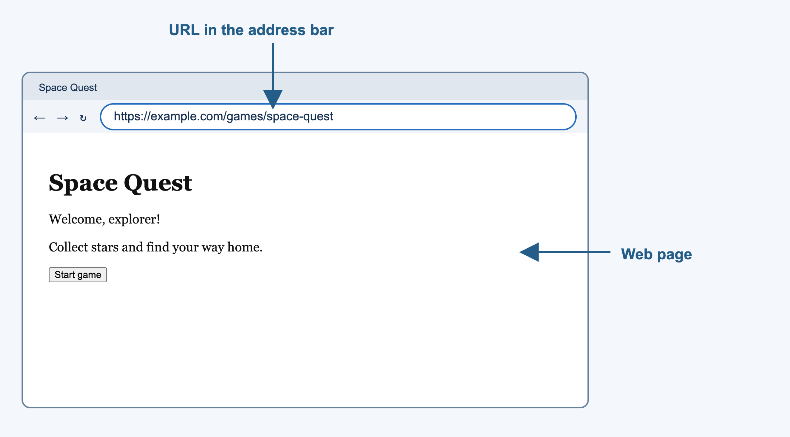
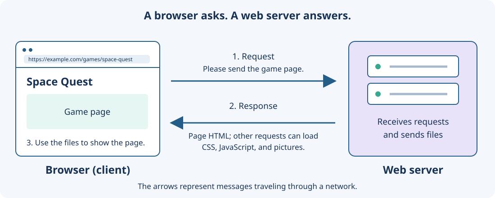

# Computer, Browser, and Web {#sec-ch01}

::: {.chapter-banner}

[WEB 01 | Before we build a web game]{.game-title}

[Hardware]{.skill-chip} [Software]{.skill-chip} [Browser]{.skill-chip} [Web]{.skill-chip} [URL]{.skill-chip} [Server]{.skill-chip}

:::

## Overview {.unnumbered}

Before you build a web game, it helps to know **where the game lives**, **what runs it**, and **how the pieces reach the screen**.

A web game may look like one thing when you play it, but several parts work together behind the scenes. Your computer provides the hardware. Programs such as a browser provide the software. Files store the pictures, sounds, page information, and game instructions. The Web lets a browser request files from other computers when those files are not already on your own computer.

You do **not** need to memorize every technical word in this chapter. The goal is to build a simple picture in your mind. Later chapters will add HTML, CSS, and JavaScript to that picture one step at a time.

::: {.callout-note title="The big picture" icon="false"}
When you play a web game, you are usually using **software** called a browser on **hardware** such as a laptop or desktop computer. The browser opens game files from your computer or receives them from a server, then uses those files to show and run the game.
:::

```{mermaid}
flowchart LR
    A[Computer hardware] --> B[Browser software]
    C[Game files] --> B
    B --> D[Web game on the screen]
```

**Read the picture:** The computer is the physical machine. The browser is a program running on that machine. The browser uses files to create the game experience you see.

## Learning Objectives {.unnumbered}

By the end of this chapter, you will be able to:

- explain the difference between a **program**, a **file**, and a **folder**;
- create, name, copy, and organize project files, then save and reopen them;
- explain what a **browser** does;
- distinguish the **Internet** from the **Web**;
- distinguish a **web page**, **website**, and **web game**;
- explain what a **URL** is and recognize its basic parts;
- describe the jobs of a **client** and a **server**;
- trace a simple **request and response** between a browser and a server;
- explain the difference between opening a **local file** and visiting a web address;
- describe, at a high level, where a web game can do its work.


### What is a program? {.unnumbered}

A **program** is a set of instructions that a computer can follow. A browser is a program. A calculator app is a program. A game is also a program.

When you start a program, the computer loads the instructions and begins carrying them out. Some programs open documents. Some programs play music. A browser opens and runs web content.

For this book, two programs will be especially important:

- A **text editor** lets you create and change code files.
- A **web browser** reads web files and shows the result.

You will spend a lot of time moving between these two programs: edit something, save it, return to the browser, and see what changed.

## Files and folders keep a project organized

Computers store information in **files**. A file can contain many kinds of information: words, pictures, music, video, data, or program instructions.

A **file name** helps you recognize a file. Many file names also end with a **file extension**, such as `.png` or `.txt`. The extension gives people and programs a clue about what kind of information the file contains.

A **folder** is a container used to organize files and other folders.

Think of a folder as a project box. If you make a space game, you want the files for that game to stay together instead of being scattered around your computer.

```text
space-game/
  index.html
  styles.css
  game.js
  images/
    spaceship.png
    planet.png
  sounds/
    launch.mp3
```

These are real web-project file names. `index.html` describes the page, `styles.css` describes its appearance, and `game.js` holds JavaScript instructions. The name `index.html` is a common starting-page name. An early example may keep all three kinds of code inside one HTML file; a larger project usually separates them.

| File category | Extensions used in this book | Browser's job |
| --- | --- | --- |
| Page | `.html` | Read the page structure and find its linked resources. |
| Stylesheet | `.css` | Apply colors, sizes, spacing, and layout rules. |
| Program | `.js` | Run the game instructions. |
| Picture | `.svg`, `.png` | Display an image or use it in a game drawing. |
| Sound | `.wav`, `.mp3` | Load audio that the game can play. |
| Data | `.json` | Read organized information, such as a level layout. |
| 3D model | `.glb` | Supply model data to the later 3D game code. |

::: {.callout-tip title="Try It: Find a file and its folder" icon="false"}
Open a folder on your computer. Pick one file and answer these questions:

1. What is the file's name?
2. Does it have a file extension?
3. Which folder contains it?
4. Which program would you use to open it?
:::


## The Internet and the Web are related, but they are not the same thing

People often use the words **Internet** and **Web** as if they mean the same thing. They are related, but they describe different ideas.

The **Internet** is a huge network that connects computers and devices around the world. It is the communication system that lets connected computers exchange information.

The **World Wide Web**, usually called the **Web**, is a system of pages and other resources that we access through the Internet, usually with a web browser.

One simple way to remember the difference is:

- **Internet:** the network that connects computers.
- **Web:** pages, sites, games, pictures, and other resources that browsers access using that network.

```{mermaid}
flowchart LR
    A[Your computer] --> B[Internet<br/>connects computers]
    B --> C[Web server]
    C --> D[Web pages and game files]
```

The Internet can be used for things other than the Web. The Web is one important service that uses the Internet.

::: {.callout-note title="A useful comparison" icon="false"}
Imagine roads connecting many towns. The **Internet** is like the road system. A **website** is like a place you can reach using those roads. A **browser** is one of the tools that helps you travel to and use that place.

The comparison is not perfect, but it can help you keep the words separate.
:::

## A browser is software that works with web resources

A **web browser** is software that helps you open and use web pages and web applications. Chrome, Edge, Firefox, and Safari are examples.

A browser can get web files in two common ways:

1. It can open files that are already stored on your computer.
2. It can request files from another computer through a network.

After it receives the files, the browser uses them to create what you see and interact with on the screen.

```{mermaid}
flowchart LR
    L[Files on your computer] -->|open| B[Browser]
    B --> S[What you see and use]
    W[Files from a web server] -->|receive| B
```

{fig-alt="A browser window with arrows pointing to the URL in the address bar and to the page content below it." width=90%}

**Read the picture:** The address bar belongs to the browser. The heading, words, and button below it belong to the web page the browser displays.

### What happens when you type something in the address bar? {.unnumbered}

The long box near the top of a browser is usually called the **address bar**. You can use it to enter a web address. Browsers can also send words from the address bar to a search engine, so typing into the address bar does not always mean that you typed a web address.

When you enter a web address, the browser tries to find the resource at that address. If the resource is on another computer, the browser sends a request for it.


## A URL tells a browser where to look

A **URL** is an address for a resource. URL stands for **Uniform Resource Locator**.

You can think of a URL as directions that help a browser locate something. That "something" might be a web page, an image, a game file, or another resource.

Here is a simple example:

```text
https://example.com/games/space-quest
```

For now, focus on three parts:

| Part | Example | What it tells us |
| --- | --- | --- |
| Scheme | `https://` | how the browser should communicate |
| Domain | `example.com` | which site or server name to contact |
| Path | `/games/space-quest` | which resource or location to ask for |

You do not need to memorize every possible URL part yet. The important idea is that a URL gives the browser an address it can use.

::: {.callout-important collapse="true" title="Advanced Study: A URL can contain more parts" icon="false"}
A URL can include additional information. For example:

```text
https://games.example.com:443/levels/maze?mode=easy#start
```

It may contain:

- a **scheme** such as `https`;
- a **host name** such as `games.example.com`;
- an optional **port** such as `443`;
- a **path** such as `/levels/maze`;
- an optional **query** such as `?mode=easy`;
- an optional **fragment** such as `#start`.

You will not need most of these pieces to begin making games. Return to them when a later project needs them.
:::

## Local files and web addresses

## Your computer toolkit {.unnumbered}

Before you make a game, meet the tools you will use. A **computer** runs programs: sets of instructions that tell it what to do. A web browser is one program. A text editor is another. You are about to write instructions that a browser can follow.

::: {.callout-important title="When do I need to install a local web server?" icon="false"}

**Chapters 3–15:** the supplied one-file games open directly in a browser. **Chapters 16–23:** all six Game Lab projects require a local HTTP server. Install **Node.js LTS** once from [nodejs.org/en/download](https://nodejs.org/en/download), then use the included Windows or Mac launcher each time you play. The [Game Lab guide](../appendices/e-game-lab.qmd) has the game-by-game requirements and step-by-step installation. The four 3D projects also need internet for library downloads by default.

:::

### Files and folders {.unnumbered}

A **file** is one named piece of information saved on a computer. A game picture, a sound, and a page of code can each be files. A **folder** is a container that helps you keep related files together. Think of a folder as a game box and the files inside as its cards, pieces, and rule sheet.

Give each game its own folder. For example, your `my-first-game` folder can hold its HTML page now and later hold pictures, sounds, and more JavaScript files. Keep those files together when you copy or move your game.

### A text editor is for code {.unnumbered}

You write code in a **plain-text editor**. It saves exactly the letters, numbers, spaces, and punctuation that you type. Many editors color code and point out mistakes; that can be helpful, but the colors are not part of the code.

A word processor is great for essays, but it may add special quotation marks, hidden formatting, or page layouts. Those extras can confuse code. Use a plain-text editor for your game files. Ask your teacher which editor is available on your computer.

### File names and extensions {.unnumbered}

The end of a file name after the final dot is its **file extension**. It helps people and programs recognize the file's job.

| File name | Extension | What it usually contains |
| --- | --- | --- |
| `index.html` | `.html` | The page structure a browser opens. |
| `main.js` | `.js` | JavaScript instructions for the browser. |
| `style.css` | `.css` | Colors, sizes, and other visual choices. |
| `level.json` | `.json` | Organized game data, such as a level layout. |
| `robot.svg` | `.svg` | A picture made from shapes and lines. |

The extension is important. `index.html` and `index.html.txt` are different files: the first is a web page, while the second is usually treated as ordinary text. Some computers hide extensions, so check the full name when you save a file. Do not rename a file just to give it a new extension; save it in the right kind of file from the start.

A browser does not always need to get a page from the Internet. It can also open a file stored directly on your computer.

A local file address may begin with `file:///`. For example:

```text
file:///Users/your-name/Documents/space-game/start.html
```

The important part is not the exact folder name. `file:///` tells you that the browser is opening a file from the local computer.

A web address often begins with `http://` or `https://`:

```text
https://example.com/games/space-quest
```

That normally tells the browser to contact a server through a network.

| Address begins with | Usual meaning |
| --- | --- |
| `file:///` | open a file stored on this computer |
| `http://` | request a web resource using HTTP |
| `https://` | request a web resource using encrypted HTTP communication |

```{mermaid}
flowchart TB
    B[Browser]
    L[Local file<br/>on your computer]
    I[Internet]
    S[Web server]
    L -->|open directly| B
    B -->|request| I
    I --> S
    S -->|response| I
    I --> B
```

**Read the picture:** A local file can go directly from storage on your computer to your browser. A web resource takes another route: the browser sends a request through the network and receives a response.

## What you need {.unnumbered}

- A modern web browser such as Chrome, Edge, Firefox, or Safari.
- A plain-text code editor available on your computer.
- A folder for each website or game containing its files. Chapter 4 begins with separate HTML and CSS files; early JavaScript examples keep their code close to the page so you can focus on the programming ideas.

::: {.callout-tip .setup title="Start with one file" icon="false"}

Create a folder named `my-game-site`. Save your first HTML page as `index.html`, not `index.html.txt`. Open it in your browser. After editing, save the file and refresh the browser. Later, module-based projects need a local development server.

:::

## Meet the browser team {.unnumbered}

Your web browser is the program that turns your game files into a page you can play. Three kinds of code often work together:

| Part | Its job | A game example |
| --- | --- | --- |
| **HTML** | Builds the page and names its parts. | A heading, a button, and a canvas. |
| **CSS** | Chooses how those parts look. | A purple button or a large play area. |
| **JavaScript** | Makes the page react and change. | Add a point when the player clicks. |

Use **Build the scene structure → Style the scene → Program game behavior**: HTML describes the first pages, CSS makes their parts readable, and JavaScript adds game operations and actions. Chapter 4 uses linked HTML and CSS files; Chapter 6 combines a styled scene and JavaScript data in one starter file.

### What “client-side JavaScript” means {.unnumbered}

The **client** is the player's browser. Client-side JavaScript runs on the same computer, tablet, or Chromebook that displays the game. When a player presses a key, the browser can run your JavaScript right there and update the picture right away.

That is different from code on a **server**—another computer that can store shared scores, accounts, or messages. Our first games do not need a server on the internet. Their rules and scores stay in the browser while the page is open.

## Run a one-file game from your drive {.unnumbered}

For the complete examples in the first chapters, you can run your game directly from your computer's drive.

1. Make a folder called `my-first-game` somewhere you can find again, such as Documents.
2. In a plain-text code editor, save the complete example as `index.html` inside that folder. Check that the name ends in `.html`, not `.html.txt`.
3. Open the folder and double-click `index.html`. Your browser should open it. You may see an address beginning with `file:///`; that means the browser opened a file from your own drive.
4. Return to the editor, make one small change, save, and refresh the browser page. On many computers, refresh is `Ctrl+R` or `Command+R`.

If double-clicking opens an editor instead of a browser, right-click the file and choose **Open with**, then choose your browser. If you cannot see the `.html` ending, ask an adult or teacher to turn on file-name extensions. A file named `index.html.txt` is a text document, not a web page.

## When a local web server helps {.unnumbered}

Some later games use several JavaScript files, images, level-data files, or 3D models. A **web server** is a small program that hands files to a browser when the browser asks for them. It is like a careful librarian: the browser asks for a particular file, and the server gives back that file.

For a one-file beginner game, `file:///` is enough. For a project that uses JavaScript `import`, JSON data, or files loaded by the game, start a **local web server** instead. A local server runs only on your own computer and gives the page an address such as `http://127.0.0.1:8000/`. Modern browsers use extra safety rules for those multi-file requests, so opening the HTML by double-clicking may not work.

`127.0.0.1` means “this same computer.” Starting this book's local server does not put your game on the internet or let classmates visit it. The Game Lab instructions in [Appendix E](../appendices/e-game-lab.qmd) show exactly how to start it.


## Client and server describe jobs

{fig-alt="A browser wireframe on the left sends a request arrow to a server on the right. A response arrow returns HTML, CSS, JavaScript, or pictures to the browser." width=100%}

When computers communicate, we often describe them by the job they are doing.

A **client** asks for or uses a service or resource. In this book, your browser often acts as a client because it asks for web files.

A **server** provides a service or resource. A web server can receive a request and send back a requested file or other data.

The words **client** and **server** describe roles. They do not always describe special kinds of hardware.

For example, your laptop is hardware. Chrome is software. When Chrome asks a web server for a page, Chrome is acting as a **client**.

A server also involves software. In everyday conversation, people sometimes use the word *server* for both the server program and the computer running that program. For now, remember the job: **a server responds to requests**.


### Request and response {.unnumbered}

A **request** is a message asking for something.

A **response** is the answer that comes back.

For a web game, a simplified conversation might look like this:

> Browser: "Please send the game page."
>
> Server: "Here it is."
>
> Browser: "Now I need a picture used by the game."
>
> Server: "Here is that picture."

Real web communication contains more details, but this request-and-response idea is the foundation.

## The game development process

Build one small feature in three passes. For **Monster Clicker**, the feature is a button that gives the player a point.

| Pass | Question to answer | Monster Clicker example |
| --- | --- | --- |
| **Structure** | What parts belong on the page? | Add a monster button and a score display with HTML. |
| **Style** | How should players recognize those parts? | Use CSS to make the button easy to see and press. |
| **Behavior** | What should happen when the player acts? | Use JavaScript to add a point when the button is pressed. |


Chapter 2 turns a game story into small feature plans. Chapter 3 builds the structure, Chapter 4 adds style, and Chapter 5 plans behavior. Keep the same small scene as you move from one pass to the next.

## How HTML, CSS, and JavaScript fit together

You will write HTML in Chapter 3 and CSS in Chapter 4. First, recognize the three jobs that work together in our games:

- **HTML** describes the page's structure and content.
- **CSS** describes much of the page's appearance and layout.
- **JavaScript** gives the page programmable behavior.

These are file types you will recognize in a project folder. Chapter 3 introduces scene structure and HTML; Chapter 4 teaches CSS style; Chapter 5 plans behavior.

| Technology | Job in a future web game | Example |
| --- | --- | --- |
| HTML | what is on the page | a score area or game button |
| CSS | how it looks | size, spacing, color, position |
| JavaScript | what it does | increase the score after an action |


Do not worry about the code yet. Chapter 3 begins with HTML and shows how a browser turns page structure into something you can see.

### The browser builds a page from connected files {.unnumbered}

The page file is the starting point. It can point to a stylesheet, pictures, and JavaScript files. The browser loads those resources, builds the page's structure, applies its styles, and runs its scripts. Loading a picture or a program may take time, so later games wait until their resources are ready.

The browser keeps a working representation of the page called the **Document Object Model**, or **DOM**. A heading, a button, and a score paragraph become elements in that representation. Chapter 3 gives some elements unique labels called **IDs**. Chapter 7 teaches JavaScript to find those elements and change them. Changing the page in the browser does not automatically change the saved HTML file.

### A first look at HTML {.unnumbered}

This tiny page contains a heading, a button, and a score. Save it as `index.html` if you want to see the unstyled parts in a browser. Chapter 3 explains how the elements fit together.

```html
<!doctype html>
<html lang="en">
<head>
  <meta charset="utf-8">
  <title>Monster Clicker</title>
</head>
<body>
  <h1 id="game-title">Monster Clicker</h1>
  <button id="monster" type="button">Click the monster</button>
  <p id="score">Score: 0</p>
</body>
</html>
```

An **ID** is a name for one element on the page. Each ID in this example is unique.

| HTML tag | Simple job | Example above |
| --- | --- | --- |
| `<html>` | Hold the whole page. | Contains the head and body. |
| `<head>` | Hold page information. | Contains the title. |
| `<title>` | Name the browser tab. | `Monster Clicker` |
| `<body>` | Hold the visible page content. | Contains the heading, button, and score. |
| `<h1>` | Show the main heading. | `Monster Clicker` |
| `<button>` | Give the player a control to press. | `Click the monster` |
| `<p>` | Show a paragraph or short status. | `Score: 0` |

### A first look at CSS {.unnumbered}

CSS changes how the same elements look. The `#` symbol selects an element by its ID; these rules use only the IDs from the HTML example. Chapter 4 shows where to place CSS and how to connect a stylesheet.

```css
#game-title {
  color: #245d88;
}

#monster {
  background-color: #e6f6f2;
  font-size: 1.25rem;
  padding: 0.75rem;
}

#score {
  font-weight: bold;
}
```

| CSS piece | What it does | Example |
| --- | --- | --- |
| `#game-title` | Selects the element with `id="game-title"`. | The heading. |
| `#monster` | Selects the element with `id="monster"`. | The button. |
| `color` | Changes text color. | `#245d88` is a blue color. |
| `background-color` | Changes the color behind an element. | A pale green button. |
| `font-size` | Changes text size. | Larger button text. |
| `padding` | Adds space inside an element. | More room around button text. |
| `font-weight` | Changes how heavy text looks. | A bold score. |

### A first look at JavaScript {.unnumbered}

JavaScript lets the browser respond to the player. You will use these browser tools in later chapters; you do not need to memorize them now.

| Browser Tool | Simple Job | Monster Clicker Example |
| --- | --- | --- |
| `document.getElementById("...")` | Find one element by its ID. | Find the monster button. |
| `addEventListener("click", ...)` | Run instructions when an event happens. | Notice a button click. |
| `textContent` | Read or change an element's text. | Show an updated score. |
| `console.log(...)` | Print a message for the developer. | Check that a click was detected. |


## Exercises {.unnumbered}

Practice the computer and file skills you will need for later projects. These are explanation and file-operation tasks; no game code is required.

### Exercise 1: Basic file operations {.unnumbered}

1. **Create a folder.** Use your computer’s file manager to make `my-game-site` in a place you can find again. A file manager may be called File Explorer or Finder.
2. **Create and save a file.** Open a plain-text editor, type `My game notes`, and save it as `notes.txt` inside that folder. Check the full file name, including its extension.
3. **Close and reopen it.** Find `notes.txt` in the file manager and open it with your editor. Its contents should still be there.
4. **Copy before experimenting.** Duplicate the file as `notes-backup.txt`. Copying keeps the original; moving changes where a file is stored. Renaming changes its name, not its contents or file format.
5. **Edit, save, and check.** Change the original notes, save, and reopen them. The backup should still contain the earlier text. When you later edit an HTML page, save in the editor and refresh in the browser to see the change.

Keep linked project files together. Moving only an HTML page can break its links to pictures or stylesheets. Use meaningful names and keep a backup before a large change.


### Exercise 2: Hardware or software? {.unnumbered}

Classify each item as **hardware** or **software**.

1. Keyboard
2. Firefox
3. Monitor
4. Text editor
5. Speakers
6. A browser game

### Exercise 3: File, folder, or program? {.unnumbered}

For each item, choose **file**, **folder**, or **program**.

1. `spaceship.png`
2. Chrome
3. `space-game/`
4. `launch.mp3`
5. A text editor
6. `images/`

### Exercise 4: Internet or Web? {.unnumbered}

Complete each sentence with **Internet** or **Web**.

1. The __________ connects computers and devices so they can exchange information.
2. The __________ includes pages and resources that a browser can access.
3. A browser normally uses the __________ to reach a website on another computer.

### Exercise 5: Page, site, or game? {.unnumbered}

Choose **web page**, **website**, or **web game**.

1. One instruction screen displayed in a browser
2. A collection containing a home page, help page, and several games
3. An interactive browser program where the player catches falling stars

### Exercise 6: Read a URL {.unnumbered}

Look at this URL:

```text
https://games.example.com/arcade/star-catcher
```

Answer the questions.

1. What is the scheme?
2. What is the domain or host name?
3. What is the path?
4. Does this look like a local file address or a web address?

### Exercise 7: Local or remote? {.unnumbered}

For each address, decide whether the browser is most likely opening a **local file** or requesting a **web resource**.

```text
file:///Users/Ari/Games/star-game/start.html
https://example.com/games/star-game
file:///C:/Games/maze/start.html
http://school.example.org/game-lab
```

### Exercise 8: Trace the request {.unnumbered}

Put these actions in a sensible order:

- The server sends a response.
- The browser shows or uses the returned resource.
- The browser sends a request.
- The player enters a web address.

### Exercise 9: Who is doing the job? {.unnumbered}

A player opens a browser and visits an online game. The browser asks another computer for the game files.

Answer these questions:

1. Which software is acting as the client?
2. What is the server's job?
3. Which part is hardware: the laptop or the browser?
4. After the files arrive, where can much of the game logic run?

### Exercise 10: Explain the picture {.unnumbered}

Draw four boxes labeled **Player**, **Browser**, **Internet**, and **Server**. Add arrows to show how a player can request a web game. Label at least one arrow **request** and one arrow **response**.

## Challenges {.unnumbered}

### Challenge 1: Explain a web game to a beginner {.unnumbered}

Imagine a friend says, "A web game is stored inside Chrome."

Write a short explanation that uses at least four of these words correctly:

**hardware, software, browser, file, Internet, Web, server, client**

### Challenge 2: Draw the journey of a game {.unnumbered}

Draw a diagram showing two ways a browser can get game files:

1. from the same computer;
2. from a web server through the Internet.

Your diagram must include **browser**, **local file**, **request**, **response**, and **server**.

Then write two or three sentences explaining the difference between the two routes.

### Challenge 3: Plan a future game project {.unnumbered}

Imagine you will keep the files for a game called **Robot Rescue**. Sketch a folder for the project. Include folders or files for at least:

- the game page;
- game instructions or code;
- images;
- sounds.

Use `index.html`, `styles.css`, and `game.js` for the three web-code files, then choose meaningful names for your pictures and sounds.

Then answer: **Why is keeping related game files in one project folder useful?**

### Challenge 4: Local game or online game? {.unnumbered}

You are designing two games:

- **Game A** is a simple maze that runs on one student's laptop.
- **Game B** lets students on different computers compare high scores online.

For each game, explain which work could happen in the browser and whether a server would be useful. You do not need to design the server; explain only the jobs it might perform.
