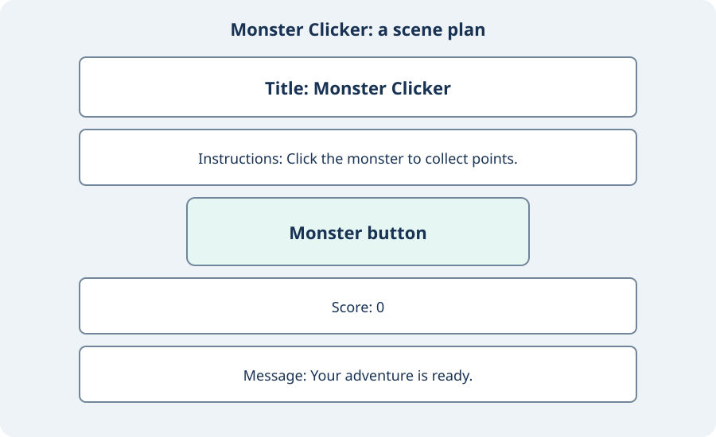
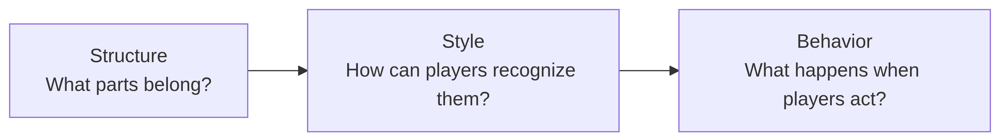

# Structure: Build the Game Scene {#sec-ch03}

::: {.chapter-banner}
[STRUCTURE 03 | Monster Clicker: the page]{.game-title}
[Ideas]{.skill-chip} [HTML]{.skill-chip} [Elements]{.skill-chip} [Nesting]{.skill-chip}
:::

## Overview {.unnumbered}

Chapter 2 turned a game story into small feature plans. Now you will build the HTML structure for the first feature: sketch the parts and create a simple page. Use your own story or try this chapter’s practice game, Monster Clicker. You will leave colors and programmed actions for the next two chapters.

Our guide is **Structure → Style → Behavior**. Start with one question: **What belongs in the scene, and how do its parts fit together?** Keep the page you build; Chapter 4 will style it, and Chapter 5 will plan its game behavior.

Open the [companion structure example](../games/foundations/structure/index.html) to inspect this stage. The chapter shows you how to build your own copy.

## Learning Objectives {.unnumbered}

By the end of this chapter, you will be able to:

- build a simple HTML page;
- describe a small game idea, story, and player goal;
- sketch a scene with instructions, controls, and a progress display;
- distinguish an HTML tag, element, and attribute;
- use the document skeleton and nest related elements;
- create and check a complete page in a browser.

## Choose one small game idea

Write three possibilities: a robot collecting gems, an astronaut catching stars, or a player clicking a monster. This is **ideation**: making possible ideas before choosing one. Pick a first version you can explain in one sentence.

We will use **Monster Clicker**: “Click a friendly monster to collect points.” The story might be that each click helps the monster wake up. The **goal** tells the player what to achieve; the story explains why they care. For this practice game, we can plan one point per tap and a five-point goal. Here, focus on the page parts those rules will need; the behavior lessons will develop and implement the rules.

Keep the first version small. One monster, one score, and one message are enough. Save extra monsters and levels for later.


## Sketch the scene structure

A **scene** includes the page and the game world the player sees and uses. List each required part and its job before thinking about colors.

{#fig-ch03-monster-wireframe fig-alt="Five labeled boxes in reading order: game title, instructions, monster button, score, and feedback message." width=85%}

**Read the sketch:** The boxes show placement and reading order, not final colors or artwork. The player reads the instructions before reaching the button, then sees the score and message below it.

| Part | Purpose | Relationship |
| --- | --- | --- |
| Title | Name the game | First visible item on the page |
| Instructions | Explain what the player can do | Above the monster |
| Monster button | Give the player a target | Below the instructions |
| Score | Show progress | Below the button |
| Message | Explain the latest result | Below the score |

Draw these parts as labeled boxes. The diagram does not need artwork. Put the instructions before the control and keep feedback nearby.


{fig-alt="" width=50% fig-align="center"}


```{mermaid}
flowchart LR
    S[Structure<br/>What parts belong?] --> T[Style<br/>How can players recognize them?]
    T --> B[Behavior<br/>What happens when players act?]
```

**Read the picture:** This chapter builds the parts. Chapter 4 makes them readable and recognizable. Chapter 5 plans the actions and results. You will reuse your work instead of rebuilding the page at every stage.

## Read an HTML element

**HTML** describes the page’s content and structure. A **tag** marks an element’s start or end. An **element** includes those tags and the content between them.

Here is the general syntax for an element with an attribute:

```text
<tag attribute="value">content</tag>
```

The opening tag is `<tag attribute="value">`; the closing tag is `</tag>`. The **tag name** says what kind of element it is. The **attribute name** and quoted **value** give extra information. The **content** appears between the tags. Together, the opening tag, content, and closing tag form the element.

```html
<h1>Monster Clicker</h1>
```

`<h1>` begins a main heading. `</h1>` ends it. `Monster Clicker` is its content. A paragraph uses `<p>...</p>`.

An **attribute** adds information inside the opening tag:

```html
<button id="monster" type="button">Monster</button>
```

`id` and `type` are attribute names. The quoted text supplies their values. An `id` identifies one element and should be unique on the page. A `class` can group several elements for shared styling. `type="button"` makes this an ordinary action button. It does not yet connect a game rule to the button.

## Build a complete page

Create `monster-scene/` inside your project folder. Save this as `index.html` with your plain-text editor. Open it in a browser.

```html
<!doctype html>
<html lang="en">
<head>
  <meta charset="utf-8">
  <meta name="viewport" content="width=device-width, initial-scale=1">
  <title>Monster Clicker</title>
</head>
<body>
  <h1>Monster Clicker</h1>
  <p>Click the monster to collect points.</p>
  <button id="monster" class="monster" type="button">Monster</button>
  <p>Score: <span id="score">0</span></p>
  <p id="message">Your adventure is ready.</p>
</body>
</html>
```

{fig-alt="An unstyled page with the heading Monster Clicker, instructions, a Monster button, Score: 0, and Your adventure is ready." width=85%}

The page uses the browser’s default appearance. Clicking the button does not increase the score. For this stage, success means the planned parts exist and appear in a useful reading order.

| Document piece | Job |
| --- | --- |
| `<!doctype html>` | Declare modern HTML; this is a declaration, not an element. |
| `<html lang="en">` | Hold the document and identify its language. |
| `<head>` | Hold information about the page. |
| `<meta charset="utf-8">` | Let the browser read the page’s text encoding. |
| Viewport `<meta>` | Set up the page for different screen widths. |
| `<title>` | Name the browser tab; it does not create the visible heading. |
| `<body>` | Hold the content people see and use. |

`<meta>` is a **void element**: it has no closing tag. The other elements here need closing tags. HTML comments, such as `<!-- My scene plan -->`, are notes for the code reader and do not appear as page text.

## Group and nest the parts

**Nesting** means putting one element inside another. In this page, the visible elements are children of `<body>`. The score paragraph contains a `<span>` for the number. The heading, instructions, button, score paragraph, and message paragraph are siblings because they share the same parent.

Inside the score paragraph, `<span id="score">0</span>` marks just the number. A later program can change that number without replacing the words `Score:`. Close an inner element before closing its parent. Indentation helps you read these relationships; spaces alone do not create them.

| HTML tool | Use it for | Small example |
| --- | --- | --- |
| `<h1>` | Main heading | `<h1>Monster Clicker</h1>` |
| `<p>` | A paragraph or short status | `<p>Ready!</p>` |
| `<span>` | A small part within a line | The score number |
| `<button>` | A control the player can press | The monster target |
| `id`, `class` | Identify one part; group parts for styling | `id="score"`, `class="monster"` |

## Exercises {.unnumbered}

### Exercise 1: Find the relationships {.unnumbered}

**Flow focus:** Structure: explain the parts and their nesting.

Draw a tree showing `<body>`, the monster button, the score paragraph, and the score span. Which element contains the score span? Which elements are siblings?

### Exercise 2: Fix the grouping {.unnumbered}

**Flow focus:** Structure: close inner elements before outer ones.

Correct this fragment, then explain the problem:

```html
<p>Score: <span>0</p></span>
```

### Exercise 3: Add one visible part {.unnumbered}

**Flow focus:** Structure: extend the page without adding appearance rules or game code.

Add a paragraph showing `Lives: 3`. Give just the number a unique ID. Save, refresh, and verify that the score still has its own ID.

### Exercise 4: Make a tiny pitch {.unnumbered}

Write: “You are ___, and your goal is to ___ by ___.” Circle the objects your page will need to show. If your sentence needs several kinds of controls or many levels, choose just one action for the first version.

### Exercise 5: Test your sketch {.unnumbered}

Ask a partner to point to the game name, the target, and the place where progress will appear. If a part is missing, add it. A paper sketch checks the arrangement; it does not test browser code.

### Exercise 6: Read before editing {.unnumbered}

Find the monster button in the HTML example earlier in this chapter. Point to its opening tag, closing tag, content, attribute names, and values. Change only its visible text to `Sleepy Monster`. Predict which part of the page will change.

### Exercise 7: Compare title and heading {.unnumbered}

Change `<title>` to `My First Game`. Save and refresh. Then change `<h1>` to `Sleepy Monster`. Explain why these changes appear in different places.

### Exercise 8: Add an instruction list {.unnumbered}

Place this list after the instructions paragraph. `<ul>` creates a bulleted list; each `<li>` creates one item.

```html
<ul>
  <li>Find the monster.</li>
  <li>Watch the score.</li>
</ul>
```

Add a third item. Check that it appears inside the same list. For a numbered sequence, use `<ol>` in place of `<ul>`.

## Challenge: Your own game scene {.unnumbered}

**Structure:** Change the title, instructions, and target to fit your tiny pitch. Add one useful display. **Style:** Keep browser defaults for now and check the reading order. **Behavior:** Write one future action and expected result in your notes.
