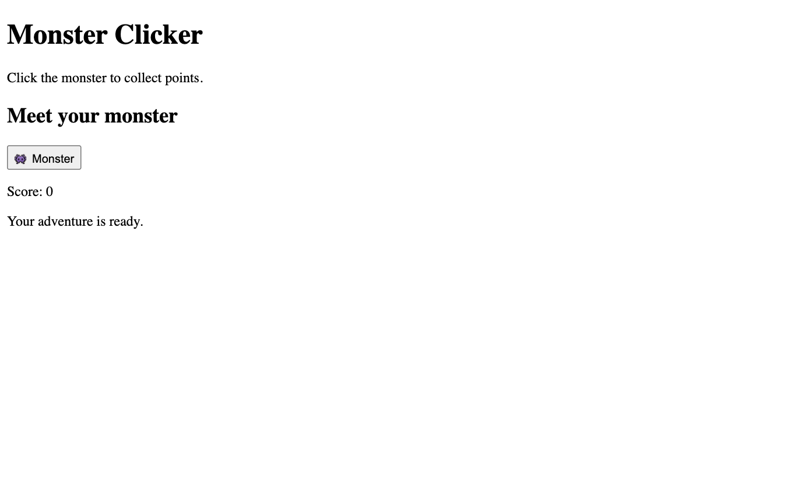
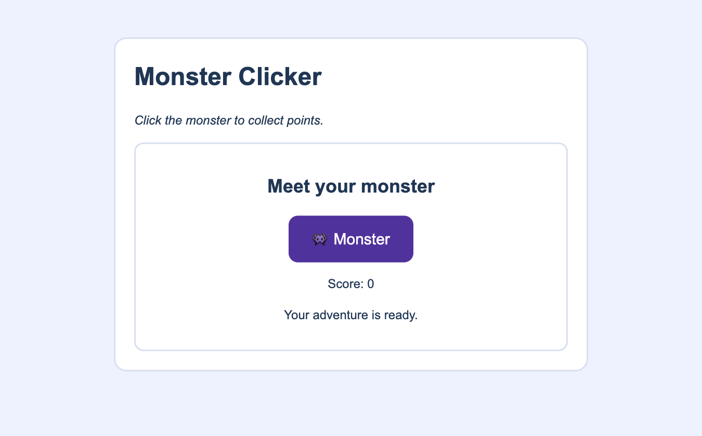
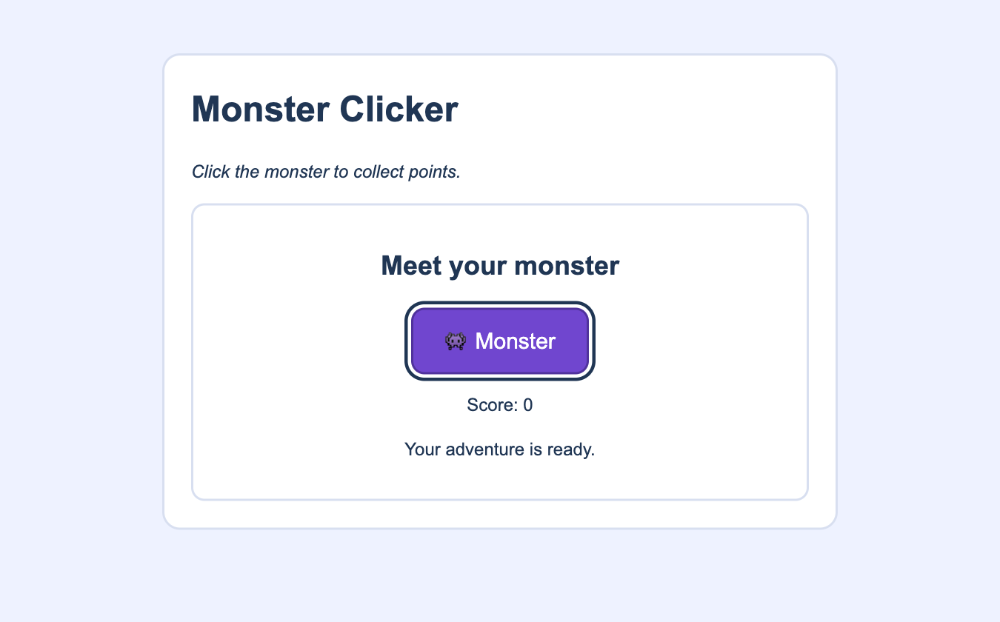

# Style: Make the Scene Readable {#sec-ch03}

::: {.chapter-banner}
[STYLE 03 | Monster Clicker: the appearance]{.game-title}
[CSS]{.skill-chip} [Selectors]{.skill-chip} [Box model]{.skill-chip} [Layout]{.skill-chip}
:::

## Overview {.unnumbered}

Your Monster Clicker page already has a title, instructions, target, score, and message. Now you will use **CSS** to make those parts easier to recognize and use. Keep the same HTML and add style a little at a time.

In **Structure → Style → Behavior**, this chapter asks **“How will the player understand what they see?”** Colors and artwork are part of style, but so are readable text, spacing, clear controls, and room for feedback. Game rules come next.

Open the [companion style example](../games/foundations/style/index.html) to inspect this stage. The chapter shows you how to build your own copy.

## Learning Objectives {.unnumbered}

By the end of this chapter, you will be able to:

- connect an HTML page to a separate stylesheet;
- read a selector, property, value, and declaration;
- use element, class, and ID selectors;
- style text, controls, and boxes;
- check layout, screen size, and keyboard focus;
- explain why a style change does not create a score rule.

## Connect a stylesheet

Create `styles.css` in the same `monster-scene/` folder as `index.html`. Add this line inside `<head>`, after `<title>`:

```html
<link rel="stylesheet" href="styles.css">
```

`<link>` is a void element. `rel="stylesheet"` identifies the linked resource’s job; `href="styles.css"` gives its location relative to the page. Save both files and refresh the browser after changes.

Start `styles.css` with one rule:

```css
body {
  color: #203654;
  font-family: Arial, sans-serif;
}
```

`body` is the **selector**: it chooses the element to style. The braces hold **declarations**. In `color: #203654;`, `color` is the property, `#203654` is its value, and the colon separates them. End each declaration with a semicolon.

## Choose the parts to style

| Selector | Meaning | Match in our page |
| --- | --- | --- |
| `h1` | Every element with this tag name | Main heading |
| `.card` | Every element with this class | `<main class="card">` |
| `.monster` | Every element with this class | Monster button |
| `#message` | The element with this ID | `<p id="message">` |

A class selector begins with a dot; an ID selector begins with `#`. The symbols belong in CSS, not in the HTML attribute values. Several elements can share a class, while each ID should identify one element.

```css
h1 { font-size: 2rem; }
.instructions { font-style: italic; }
#message { min-height: 1.5em; }
```

`rem` measures size relative to the root font size. `em` relates to a font size; here it reserves space based on the message’s own font. You can begin with these values without memorizing every CSS unit.

## Give each box room

Every element takes up space. Its **content** sits inside **padding**, then a **border**. **Margin** separates that box from neighboring content.

```css
.card {
  max-width: 38rem;
  margin: 2rem auto;
  padding: 1.5rem;
  border: 2px solid #d8dff0;
  border-radius: 1rem;
  background: white;
}
```

`max-width` limits the card’s width. `margin: 2rem auto` gives it space above and below and shares remaining horizontal space between its sides, centering the card. Padding keeps the text away from the border. `border-radius` rounds the corners.

We will use `box-sizing: border-box` so a stated width includes padding and border. Otherwise, those are added to the content width.

## Build the complete style in small steps

Use this complete stylesheet after trying the smaller rules. It styles the page from Chapter 2; it does not change that page’s game rules.

```css
* {
  box-sizing: border-box;
}
body {
  margin: 0;
  padding: 1rem;
  background: #eef2ff;
  color: #203654;
  font-family: Arial, sans-serif;
  line-height: 1.5;
}
.card {
  max-width: 38rem;
  margin: 2rem auto;
  padding: 1.5rem;
  border: 2px solid #d8dff0;
  border-radius: 1rem;
  background: white;
}
h1 {
  margin-top: 0;
  font-size: 2rem;
}
.instructions {
  font-style: italic;
}
.arena {
  padding: 1rem;
  border: 2px solid #d8dff0;
  border-radius: .75rem;
  text-align: center;
}
.monster {
  min-width: 10rem;
  padding: .8rem 1.2rem;
  border: 2px solid #50329c;
  border-radius: .75rem;
  background: #7046cf;
  color: white;
  font: inherit;
  font-size: 1.25rem;
  cursor: pointer;
}
.monster:hover {
  background: #50329c;
}
.monster:focus-visible {
  outline: 3px solid #203654;
  outline-offset: 3px;
}
#message {
  min-height: 1.5em;
}
```

<!-- game-stage-figures:style -->

{#fig-ch03-stage-html fig-alt="Structure: HTML only, before CSS or JavaScript." width="100%"}

{#fig-ch03-stage-style fig-alt="Style: the same HTML with CSS applied; JavaScript is still off." width="100%"}

{#fig-ch03-style-hover fig-alt="CSS feedback: hovering over the monster darkens its button. The score stays at zero." width="100%"}

{#fig-ch03-style-focus fig-alt="CSS feedback: keyboard focus outlines the monster button. No click rule has been added." width="100%"}

<!-- /game-stage-figures:style -->

`*` selects all elements. `line-height` gives lines of text breathing room. Many text settings pass from a parent to its children through **inheritance**; `font: inherit` explicitly tells the button to use its parent’s font settings.

`:hover` selects the button while a pointer is over it. `:focus-visible` provides a visible outline when focus should be shown, such as during keyboard navigation. The color change and outline are CSS responses. They do not count points or run a game rule.

## Add a local picture when it helps

For an optional picture, copy the supplied [gem.svg](../games/assets/2d/gem.svg) into your `monster-scene/` folder. Add this below the instructions:

```html

```

`src` names the file; `alt` gives its text alternative. `` has no closing tag. This is a structure addition, so check that the file loads before styling it.

```css
.game-art {
  width: 6rem;
  max-width: 100%;
  height: auto;
  padding: .5rem;
  border: 2px solid #d8dff0;
  border-radius: .75rem;
}
```

`height: auto` keeps the image’s proportions. A picture of a gem does not automatically make it collectible. Chapter 4 will help you describe the rule you would need.

## Read the basic CSS summary

| Job | Properties in this lesson | Check |
| --- | --- | --- |
| Text | `font-family`, `font-size`, `font-style`, `font`, `line-height`, `text-align`, `color` | Labels and instructions are readable. |
| Box size | `box-sizing`, `width`, `height`, `min-width`, `max-width`, `min-height` | The target and display fit their intended space. |
| Spacing | `margin`, `margin-top`, `padding` | Parts do not crowd their borders or neighbors. |
| Appearance | `background`, `border`, `border-radius` | Important parts are easy to distinguish. |
| Control feedback | `cursor`, `outline`, `outline-offset` | Pointer and keyboard users can recognize the target. |

Later games need Flexbox, Grid, positioning, responsive rules, and canvas sizing. The [HTML/CSS reference](../appendices/f-html-css-reference.qmd#ref-css-reference) explains them with examples. Look up one technique when your project needs it; you do not need to learn the entire property catalog now.

## Exercises {.unnumbered}

### Exercise 1: Read a rule {.unnumbered}

**Flow focus:** Style: identify how an existing part’s appearance changes.

In `.monster { color: white; }`, name the selector, property, and value. Predict what changes and what stays the same.

### Exercise 2: Make room for feedback {.unnumbered}

**Flow focus:** Style: keep a changing message readable.

Give `#message` a pale background and some padding. Check that it is still easy to distinguish from the monster button.

### Exercise 3: Investigate a broken style {.unnumbered}

**Flow focus:** Structure + Style: check the connection between an element and its rule.

A friend writes `monster { background: purple; }`, but their button has `class="monster"`. Explain the mismatch, fix it, and verify the result.

### Exercise 4: Test the connection {.unnumbered}

Change the color to `purple`, save, and refresh. The page text should change. If it does not, check the file name, folder, and `href` spelling. Return to the original color after the test.

### Exercise 5: Choose the right selector {.unnumbered}

Make every `h2` heading purple. Then make only the instructions italic. Explain why one selector has a dot and the other does not.

### Exercise 6: Padding or margin? {.unnumbered}

Increase the card’s padding, save, and observe the gap between text and border. Restore it, then increase the top/bottom margin. Explain which gap changed each time.

### Exercise 7: Check the player’s view {.unnumbered}

Open the page. Find the instructions, monster, score, and message. Move the pointer over the monster, then press Tab until the button receives focus. Check that you can tell which control is selected. Make the browser narrower and check that the card stays within the page.

### Exercise 8: Predict an image change {.unnumbered}

In the `.game-art` CSS rule, change only the width. Predict whether the image will stretch or keep its proportions, then check. Add a background color and explain whether you changed the picture file or the CSS box around it.

## Challenge: Style your own scene {.unnumbered}

**Structure:** Reuse your Chapter 2 page. **Style:** Choose a readable palette, a clear target, and useful spacing. Check narrow-screen layout and keyboard focus. **Behavior:** Confirm that pressing the target still does not change the score; style has not created that rule.
