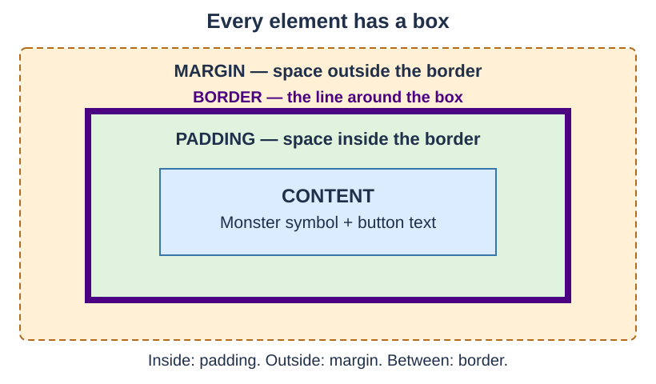
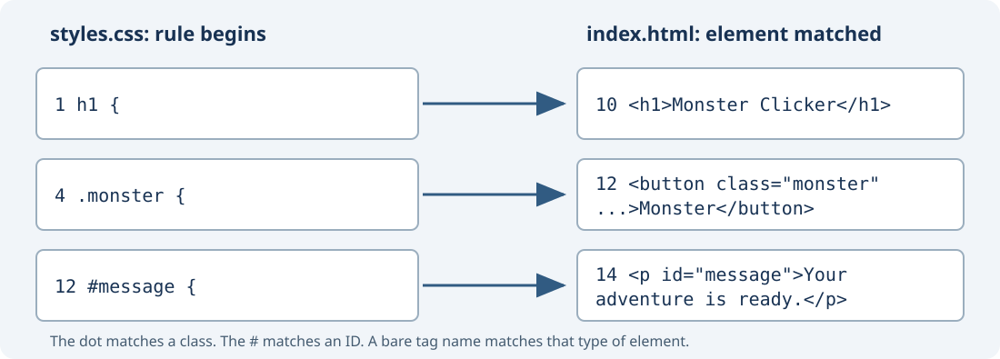
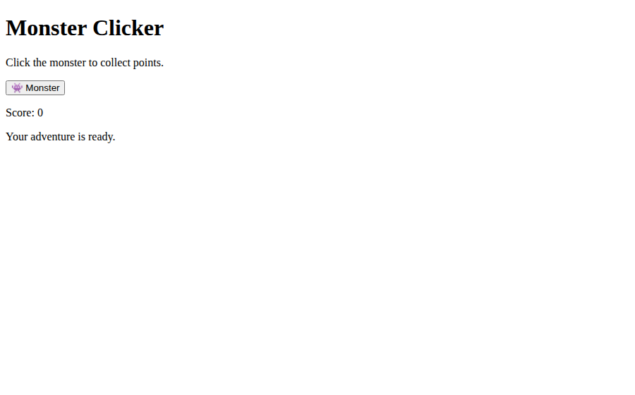
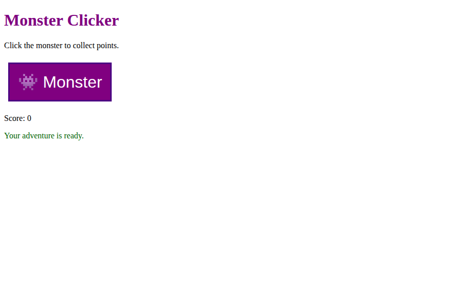

# Style: Make the Scene Readable {#sec-ch04}

::: {.chapter-banner}
[STYLE 04 | Monster Clicker: a few simple changes]{.game-title}
[CSS]{.skill-chip} [Selectors]{.skill-chip} [Box model]{.skill-chip}
:::

## Overview {.unnumbered}

Your Chapter 3 page already has the parts of Monster Clicker. Now use **CSS** to change just three of them: the heading, the monster button, and the message. Keep the browser's usual appearance for everything else.

In **Structure → Style → Behavior**, style helps players recognize the parts and read the page. Making the button purple does not make it count points; the behavior lessons will connect that action.

Open the [companion style example](../games/foundations/style/index.html) to see the result.

## Learning Objectives {.unnumbered}

By the end of this chapter, you will be able to:

- connect a stylesheet to an HTML page;
- read a simple CSS rule and choose an element to style;
- explain content, padding, border, and margin;
- change a few parts of a page and check the result.

## Connect a stylesheet

Create `styles.css` beside your Chapter 3 `index.html`. Add this line inside `<head>`, after `<title>`:

```html
<link rel="stylesheet" href="styles.css">
```

`href` tells the browser where to find the stylesheet. Save both files and refresh the page after a change.

The general syntax of a CSS rule is:

```text
selector {
  property: value;
}
```

The **selector** chooses HTML elements. The **property** (style key) names the appearance to change, and the **value** says how to change it. A rule can contain several property–value pairs between its braces.

Start with one rule in `styles.css`:

```css
h1 {
  color: purple;
}
```

`h1` is the **selector**: it chooses the main heading. Inside the braces, `color` is the **property** and `purple` is its **value**. The colon separates them; the semicolon ends the declaration. This rule makes the heading text purple.

## Choose only the parts you want to change

We will use three selectors from the existing HTML:

| Selector | Chooses | HTML it matches |
| --- | --- | --- |
| `h1` | Main headings | `<h1>Monster Clicker</h1>` |
| `.monster` | Elements with the class `monster` | `<button class="monster" ...>` |
| `#message` | The element with the ID `message` | `<p id="message">...</p>` |

A dot selects a **class**; a `#` selects an **ID**. Write those symbols in CSS, not in the HTML attribute values. A class can be shared by several elements; an ID identifies one element on the page.

## Understand the box model

Think of an element as a box with four layers:

{#fig-ch04-box-model fig-alt="Four nested areas show margin on the outside, a dark border, padding inside the border, and content in the center. Padding separates the content from the border. Margin separates the border from nearby elements." width="100%"}

| Layer | Meaning | On our monster button |
| --- | --- | --- |
| **Content** | The text or picture inside the element. | The monster symbol and word Monster. |
| **Padding** | Space between the content and its border. | Room inside the button around its label. |
| **Border** | The line around the padded content. | An indigo outline around the button. |
| **Margin** | Space outside the border. | A gap between the button and nearby parts. |

**Padding makes room inside; margin makes room outside.** The border sits between them. The diagram colors label the layers; margin itself is transparent.

We will use `padding: 16px`, `border: 3px solid indigo`, and `margin: 8px` on the monster button. `px` means pixels. One padding or margin value applies to all four sides. The border declaration gives its thickness, line style, and color.

## Style three parts of the game

Replace the contents of `styles.css` with this complete short stylesheet:

```css
h1 {
  color: purple;
}
.monster {
  font-size: 32px;
  color: white;
  background: purple;
  padding: 16px;
  border: 3px solid indigo;
  margin: 8px;
}
#message {
  color: darkgreen;
}
```

The arrows below connect each CSS selector to the line of HTML it styles in the [companion style page](../games/foundations/style/index.html). The stylesheet line numbers match the complete CSS example above.

{#fig-ch04-css-html-map fig-alt="Three arrows connect CSS line 1 h1 to HTML line 10 heading, CSS line 4 .monster to HTML line 12 button class, and CSS line 12 #message to HTML line 14 paragraph ID." width="100%"}

<!-- game-stage-figures:style -->

{#fig-ch04-stage-html fig-alt="Structure: HTML only, before CSS or JavaScript." width="100%"}

{#fig-ch04-stage-style fig-alt="Style: the same HTML with CSS applied; JavaScript is still off." width="100%"}

<!-- /game-stage-figures:style -->

The heading becomes purple. The monster button gets larger text, white letters on purple, and space inside and outside its border. The message becomes dark green. The instructions, score, and page arrangement keep their browser defaults.

Save, refresh, and compare the two views. Press Tab to find the monster button: the browser still supplies its normal keyboard focus indicator. Pressing the button leaves the score at zero because this page has no scoring rule yet.

## Exercises {.unnumbered}

### Exercise 1: Read a rule {.unnumbered}

In `h1 { color: purple; }`, name the selector, property, and value. Which part of the page changes?

### Exercise 2: Padding or margin? {.unnumbered}

Change only the button's padding from `16px` to `24px`. Save and refresh. Notice the space inside the border. Restore it, then change only the margin from `8px` to `24px`. Which outside gap changes?

### Exercise 3: Change the border {.unnumbered}

Change the button's border from `3px solid indigo` to `5px solid darkgreen`. Predict what will change, then check. Does the score rule change too?

### Exercise 4: Fix a selector {.unnumbered}

A friend writes `monster { background: purple; }`, but the button has `class="monster"`. Fix the selector and explain why the dot matters.

## Challenge: Make a few useful changes {.unnumbered}

**Structure:** Reuse your Chapter 3 page. **Style:** Change the heading color, button padding, and message color. Keep the text readable and use Tab to find the button. **Behavior:** Check that the score still stays at zero.

Use the [HTML/CSS reference](../appendices/f-html-css-reference.qmd#ref-css-reference) when a later game needs more styling tools.
