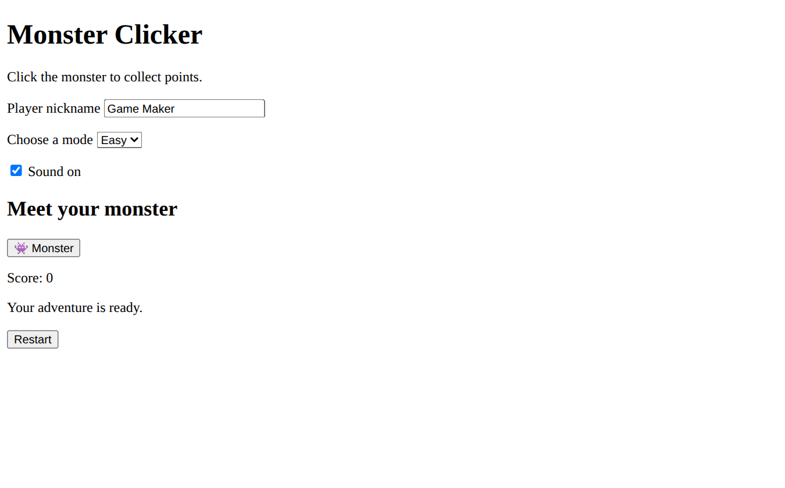
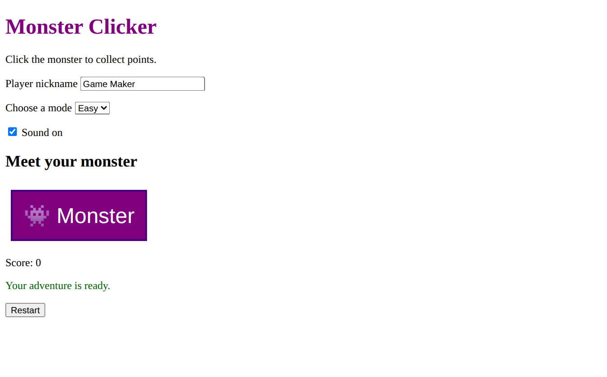
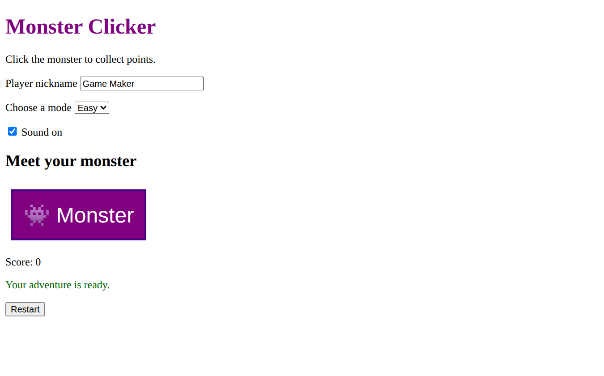
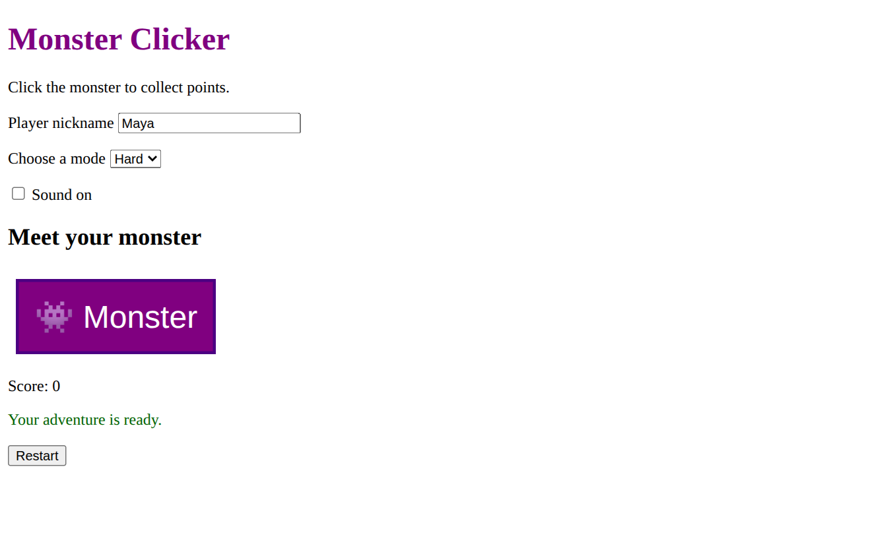
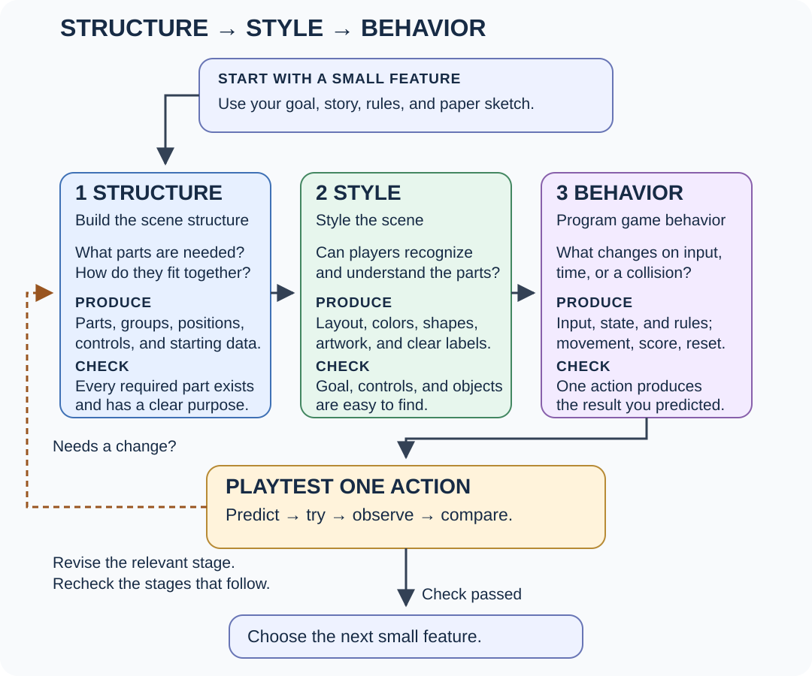

# Behavior: Plan Actions and Game Rules {#sec-ch05}

::: {.chapter-banner}
[BEHAVIOR 05 | Monster Clicker: the action plan]{.game-title}
[Input]{.skill-chip} [State]{.skill-chip} [Rules]{.skill-chip} [Feedback]{.skill-chip} [Testing]{.skill-chip}
:::

## Overview {.unnumbered}

Your scene has parts and a readable style. It still needs rules that connect player actions to changes. This chapter introduces **behavior** using small examples, a paper simulation, and browser controls. You will describe what should happen before learning the JavaScript that implements it.

Keep the same Monster Clicker page. In **Structure → Style → Behavior**, your next question is **“What happens when the player acts?”** Chapter 6 will prepare game memory; Chapter 7 will connect clicks to that memory and the page.

Open the [companion behavior example](../games/foundations/behavior/index.html) to inspect this stage. The chapter shows you how to build your own copy.

## Learning Objectives {.unnumbered}

By the end of this chapter, you will be able to:

- distinguish appearance from programmed game behavior;
- describe input, remembered state, a rule, and visible feedback;
- predict an action’s result and check it with a paper simulation;
- add labeled input controls and explain their native browser behavior;
- plan a restart rule and choose the stage to revisit after a test.

## Describe one action and result

Start with one rule in ordinary words:

> When the player hits the monster, increase the score by one and show a message.

A **behavior** describes what the game does when something happens. **Input** is information from the player, such as a click, key press, or choice. **State** is information the game remembers. A **rule** decides how that state changes. **Feedback** shows or communicates the result.

| Part of the action | Monster Clicker example |
| --- | --- |
| Input | The player presses the monster button. |
| State before | The score is zero. |
| Rule | Add one point for one hit. |
| State after | The score is one. |
| Feedback | Show the new score and a hit message. |

Changing the button’s color is a style change. Changing how many points a hit earns is a behavior change. Adding a new score display is a structure change. One feature may need all three responsibilities.

## Run the rule on paper

Draw the monster, score, and message on a sheet of paper. Write `0` in the score area. One person is the player; another carries out the rule exactly as written.

1. The player points to the monster to represent a hit.
2. The rule keeper adds one to the remembered score.
3. The rule keeper writes the new score and a message.
4. Repeat the action twice more.

| Action | Score before | Rule | Score after |
| --- | --- | --- | --- |
| First hit | 0 | Add 1 | 1 |
| Second hit | 1 | Add 1 | 2 |
| Third hit | 2 | Add 1 | 3 |

This makes the expected results explicit. It does not prove that the browser will receive a click or that future code is correct. It gives you a rule and test cases for that code.

## Choose controls for player input

Your monster is already a `<button>`. Add a nickname field above the arena, inside `<main>`:

```html
<p>
  <label for="player-name">Player nickname</label>
  <input id="player-name" name="player-name" type="text" value="Game Maker">
</p>
```

`<label>` names the control. Its `for` value matches the input’s unique `id`. Clicking the label focuses the field. `type="text"` chooses a text box, `value` supplies its initial value, and `name` identifies the field for form data. `<input>` is a void element.

Your future rule could be: “When a round starts, read the nickname and use it in the welcome message.” Typing a name alone does not implement that rule.

### Add a choice menu {.unnumbered}

```html
<p>
  <label for="difficulty">Choose a mode</label>
  <select id="difficulty" name="difficulty">
    <option value="easy">Easy</option>
    <option value="hard">Hard</option>
  </select>
</p>
```

`<select>` creates the menu. Each `<option>` supplies a choice; its `value` is the data associated with that choice. Selecting Hard changes the menu’s selected value. It does not automatically change a game’s difficulty. Your program must read the choice and apply a rule.

### Add an on/off choice {.unnumbered}

```html
<p>
  <label><input id="sound" type="checkbox" checked> Sound on</label>
</p>
```

<!-- game-stage-figures:controls -->

These views show all three controls together in the companion scene. Typing and selecting use built-in browser behavior; the game’s scoring rules are still a plan.

{#fig-ch05-stage-html fig-alt="Structure: HTML only, before CSS or JavaScript." width="100%"}

{#fig-ch05-stage-style fig-alt="Style: the same HTML with CSS applied; JavaScript is still off." width="100%"}

{#fig-ch05-behavior-controls-default fig-alt="Native controls: the nickname, mode, and sound choices before editing. The game rules are still a plan." width="100%"}

{#fig-ch05-behavior-controls-changed fig-alt="Native controls after typing Maya, choosing Hard, and turning Sound off. These controls do not yet change the score." width="100%"}

<!-- /game-stage-figures:controls -->

A checkbox toggles on or off. Putting it inside its label also connects the label and control. `checked` is a Boolean attribute: its presence sets the initial checked state. Write it without `="false"`; that text would still leave the attribute present.

| Control | Native browser response | Game behavior to program later |
| --- | --- | --- |
| Text input | Accept typing | Use the nickname in the game. |
| Select menu | Change the selected option | Apply the chosen mode’s rules. |
| Checkbox | Toggle checked state | Enable or disable game sound. |
| Button with `type="button"` | Accept focus and activation | Start, hit, or restart according to your rule. |

These native responses make the controls usable. They are different from your programmed game operations. The [reference appendix](../appendices/f-html-css-reference.qmd) covers forms and extra controls such as sliders and color inputs when a later task needs them.

## Plan conditions, goals, and reset

A story gives the action meaning; a rule gives it an exact result. For example, “Wake the sleepy monster” is a story goal. “After five points, display ‘Awake!’” is a testable rule.

| Situation to test | Expected result for this small plan |
| --- | --- |
| Open the page | Score begins at zero; a ready message appears. |
| Hit once | Score increases by one. |
| Reach five points | Message shows `Awake!`. |
| Hit again | Decide whether play continues or ends; write that rule first. |
| Restart | Restore score zero and the ready message. |

Choose one clear end rule. If five points ends the round, later hits should not earn points until restart. If play continues, the score can keep growing. Neither choice comes automatically from the HTML or CSS.

The repeated player activity—hit, see progress, decide to hit again—is a **core play loop**. It describes play. The later animation loop describes repeating work in code; the two ideas have different jobs.

## Connect and test all three stages {#sec-ch05-development-flow}

Use the full guide now that you have practiced each responsibility separately:

**Build the scene structure → Style the scene → Program game behavior.**

{#fig-ch05-development-flow fig-alt="Structure produces parts and relationships, Style produces a readable appearance, and Behavior produces actions and rules. Each stage has a check. Playtesting compares predicted and observed results, then leads to revising a stage or choosing the next small feature." width="100%"}

**Read the arrows:** Begin with one small feature based on your idea and rules. Follow the solid arrows and check each stage. The dashed arrow means that a test revealed a needed change. Return to the responsible stage, then recheck the stages that depend on it. Reuse what already meets the task.

For a gem-collection feature, **Structure** supplies a gem, a count, and a collected/not-collected state. **Style** makes the gem and count recognizable. **Behavior** removes an uncollected gem and increases the count only once.

Predict the result before trying an action. If the counter is missing, revisit Structure. If it is hard to read, revisit Style. If one gem earns points twice, investigate Behavior. After the change, test the complete collection action again.

Use simple shapes and readable labels first; finished artwork can wait. A new behavior may need another control or display. This is a development strategy, separate from browser file-loading order.

## Exercises {.unnumbered}

### Exercise 1: Predict a sequence {.unnumbered}

**Flow focus:** Behavior: apply a rule to remembered state.

Start at zero and add two points for each hit. Predict the score after four hits. Then simulate the actions on paper and compare the results.

### Exercise 2: Choice or game rule? {.unnumbered}

**Flow focus:** Structure + Behavior: distinguish a control’s value from the rule that uses it.

A player chooses Hard, but the game still awards one point per hit. Explain why adding a menu is not enough to change that rule. Write one possible rule for Hard mode.

### Exercise 3: Test restart {.unnumbered}

**Flow focus:** Behavior: restore a known starting state.

A game restarts with score zero but still says `Awake!`. Describe the missing reset operation and a test that would reveal the problem.

### Exercise 4: Separate the responsibilities {.unnumbered}

Classify these changes: add a lives display; give the display more spacing; reduce lives after a missed action. Name each stage and explain your choice.

### Exercise 5: Change one rule {.unnumbered}

Make each hit earn two points instead. Predict the first three scores before simulating them. Which page elements and CSS rules can remain unchanged?

### Exercise 6: Check the label connection {.unnumbered}

Click the label, type a nickname, and use Tab to move away. Check that the text field received focus. Temporarily misspell the label’s `for` value, observe what changes, and restore it.

### Exercise 7: Add a restart control {.unnumbered}

Add `<button id="restart" type="button">Restart</button>` after the message. Give it a little margin using Chapter 4’s approach, then use Tab to check the browser’s keyboard focus indicator. Write the values and messages that Restart should restore. Pressing it does not run that plan yet; the event lesson will connect it.

## Challenge: Your action plan {.unnumbered}

**Structure:** Reuse your scene and add only the controls or displays your idea needs. **Style:** Make them readable and test their focus. **Behavior:** Write three action/result pairs, an end rule, and a restart rule. Simulate one successful action, one boundary case, and one restart.
