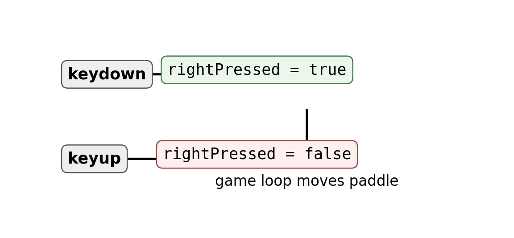
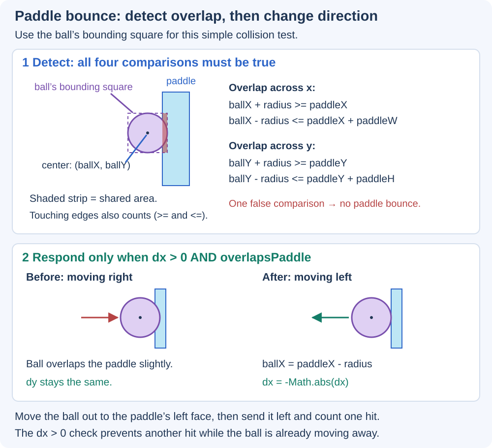
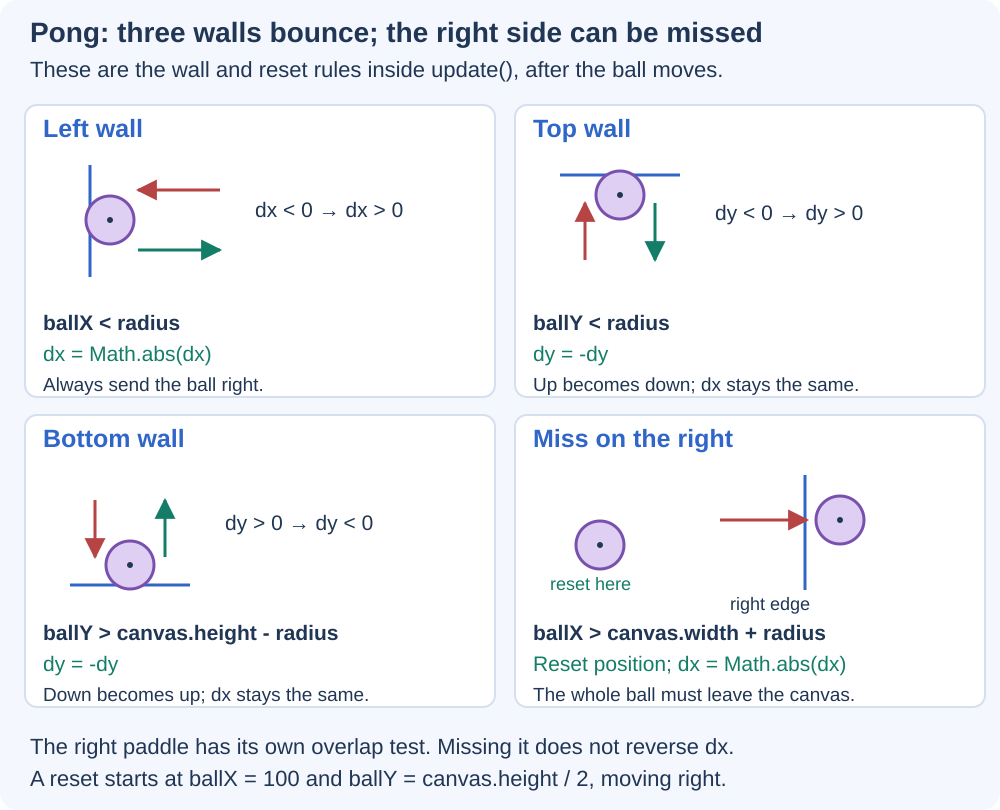
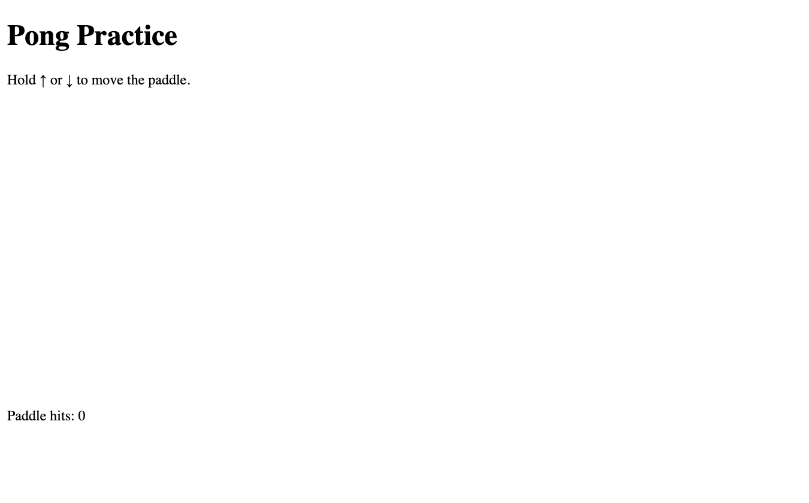
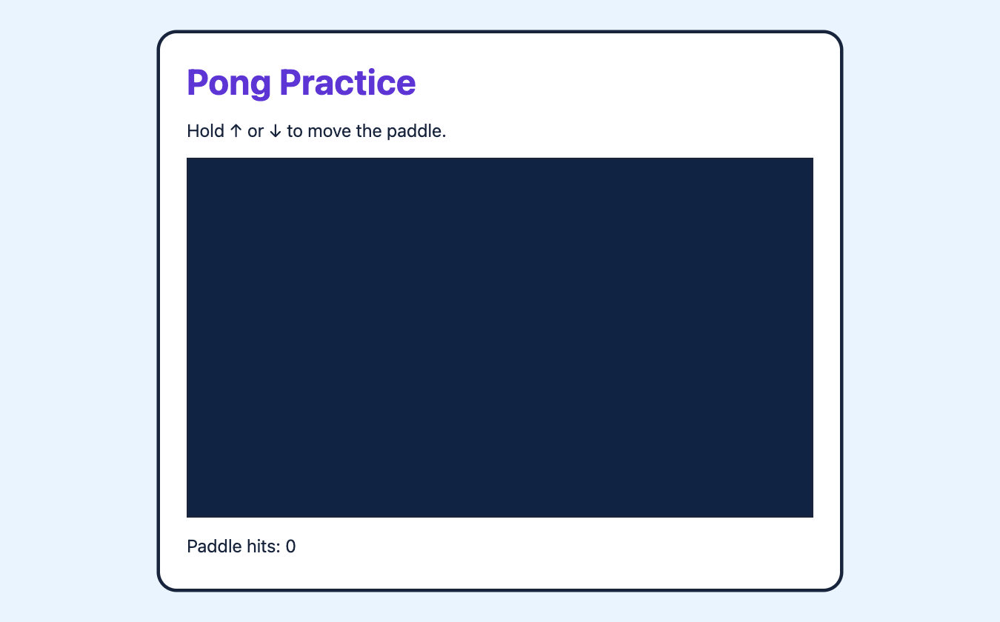
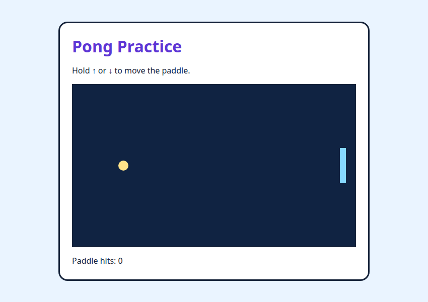
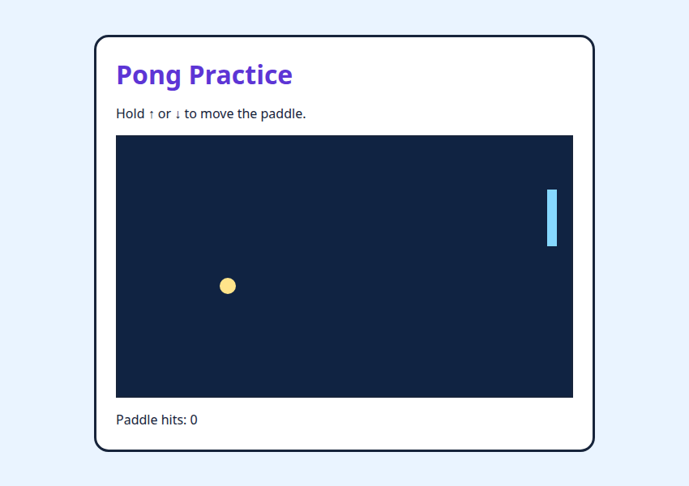
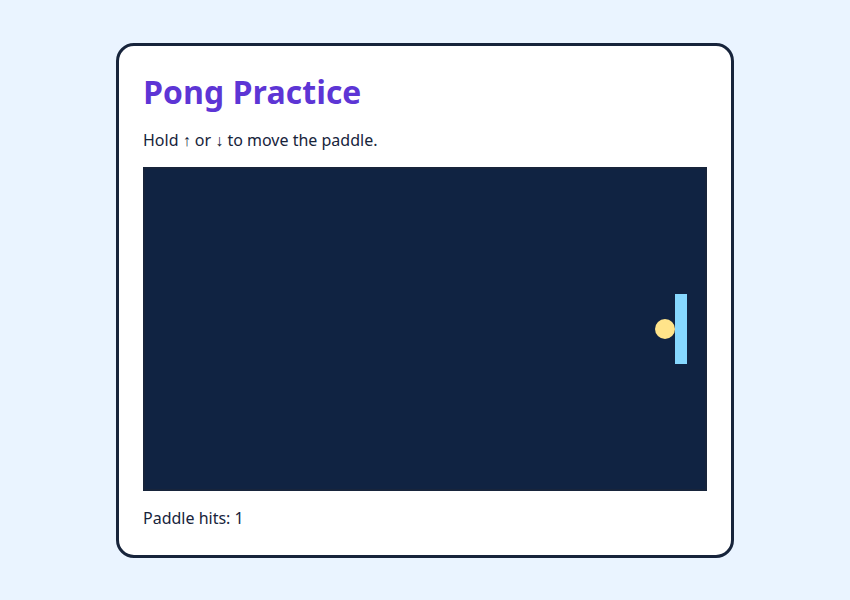

# Control a Real-Time Game {#sec-ch12}

::: {.chapter-banner}

[GAME 12 | Pong]{.game-title}

[Keyboard input]{.skill-chip} [State]{.skill-chip} [Collision]{.skill-chip}

:::

## Overview {.unnumbered}

In a real-time game, a key press should change what happens during the next frames. Instead of moving once per key event, we remember which keys are held down.

## Learning Objectives {.unnumbered}

By the end of this chapter, you can:

- track pressed keys
- move a paddle every frame
- detect simple rectangle/ball collisions

::: {.callout-note .big-idea title="Structure → Style → Behavior" icon="false"}

**Build the scene structure → Style the scene → Program game behavior.**

- **Build the scene structure:** Place the canvas, paddles, ball, instructions, and score display.
- **Style the scene:** Draw distinguishable paddles and ball and make the controls and score legible.
- **Behavior:** Read held keys, update movement, resolve paddle hits, and test scoring and misses.

Use this plan for the examples and exercises below. Reuse parts that already work; change only what the task needs. After each step, predict one result and check it.

:::


::: {.callout-note .code-guide title="How to use the code pieces" icon="false"}

The short snippets below explain individual rules. The complete browser example later in this chapter combines them into a playable page.

:::

## Remember key state

`keydown` sets a state to `true`. `keyup` changes it back to `false`.

{#fig-ch12 fig-alt="Keydown sets a pressed flag to true, keyup sets it to false, and the game loop uses the flag." width="100%"}

**Read the picture:** An event changes a remembered value. The loop can then read that value on many frames. The picture uses a right-arrow flag; Pong uses the same idea for the up and down arrows.

```javascript
const keys = {};

window.addEventListener("keydown", e => {
  keys[e.key] = true;
});
window.addEventListener("keyup", e => {
  keys[e.key] = false;
});
```

## Move during the update

The game loop checks the state every frame.

```javascript
if (keys["ArrowUp"]) paddleY -= 5;
if (keys["ArrowDown"]) paddleY += 5;
```

## Keep the paddle on the screen

`Math.max` and `Math.min` can clamp a value inside a range.

```javascript
paddleY = Math.max(0, paddleY);
paddleY = Math.min(canvas.height - paddleH, paddleY);
```

## Paddle collision idea

For a first Pong game, place a vertical paddle on the right. Here, paddleX and paddleY are its top-left coordinates, paddleW and paddleH are its size, and positive dx means the ball is moving right. Test the ball bounding box against the paddle before reversing direction.

{#fig-ch12-paddle-bounce fig-alt="A dashed bounding square around the ball overlaps the right paddle. Four comparisons test overlap on x and y. Before-and-after pictures show the center moved one radius left of the paddle and dx changed from positive to negative." width="100%"}

```javascript
const overlapsPaddle = (
  ballX + radius >= paddleX &&
  ballX - radius <= paddleX + paddleW &&
  ballY + radius >= paddleY &&
  ballY - radius <= paddleY + paddleH
);
if (dx > 0 && overlapsPaddle) {
  ballX = paddleX - radius;
  dx = -Math.abs(dx);
}
```

**Read the picture and code:** The first two comparisons test horizontal overlap; the last two test vertical overlap. `&&` means **and**, so all four must be true. For example, a ball above the paddle fails the vertical test even if it has reached the paddle's x position. The `>=` and `<=` comparisons include touching edges. This beginner version uses the square around the circle, so it can also count a near-corner overlap where the drawn circle does not quite touch.

The response has two jobs. First, `ballX = paddleX - radius` places the ball just outside the paddle, with its right edge at `paddleX`. Then `dx = -Math.abs(dx)` sends it left, keeping the same horizontal speed. `dy` stays unchanged. The `dx > 0` guard allows a hit only while moving right, so a ball already moving away does not bounce again or add another hit.

**Wall bounces and a miss:** The complete example below also checks the left, top, and bottom edges after moving the ball. Follow each rule in the next diagram, then find its matching `if` statement inside `update()`.

{#fig-ch12-wall-bounces fig-alt="Four panels show the left wall setting dx positive, the top and bottom walls negating dy, and a ball fully past the right edge resetting to its starting position." width="100%"}

**Read the wall rules:** At the left wall, `Math.abs(dx)` makes horizontal velocity positive, so the ball travels right. At the top or bottom, `dy = -dy` reverses vertical direction. As in Chapter 11, these strict wall comparisons trigger just past the contact limit. A right-side miss uses a different limit: `ballX > canvas.width + radius`. Only then has the whole ball left the canvas. The game resets its center to `(100, canvas.height / 2)` and makes `dx` positive; it keeps the current `dy` and hit count. The paddle's overlap check runs before this miss check.

## Play Pong in your browser {.unnumbered}

Save this page as `index.html`, or open `workspace/chapter9-pong/index.html`. Hold the up or down arrow to move the right paddle. The game loop reads the remembered key state every frame and checks whether the ball overlaps the paddle.

[COMPLETE EXAMPLE | `index.html`]{.code-label}

```html
<!doctype html>
<html lang="en">
<head>
  <meta charset="utf-8">
  <meta name="viewport" content="width=device-width, initial-scale=1">
  <title>Pong Practice</title>
  <style>
    body { margin: 0; min-height: 100vh; display: grid; place-items: center; background: #eaf4ff; font-family: system-ui, sans-serif; color: #17243b; }
    main { padding: 24px; border: 3px solid #17243b; border-radius: 18px; background: white; }
    h1 { margin: 0 0 8px; color: #5d35d5; }
    canvas { display: block; border: 2px solid #17243b; background: #102342; }
    #status { min-height: 1.5em; margin-bottom: 0; }
  </style>
</head>
<body>
  <main>
    <h1>Pong Practice</h1>
    <p>Hold ↑ or ↓ to move the paddle.</p>
    <canvas id="game" width="560" height="320"></canvas>
    <p id="status">Paddle hits: 0</p>
  </main>
  <script>
    const canvas = document.getElementById("game");
    const ctx = canvas.getContext("2d");
    const status = document.getElementById("status");
    const keys = {};
    window.addEventListener("keydown", e => {
      if (e.key === "ArrowUp" || e.key === "ArrowDown") e.preventDefault();
      keys[e.key] = true;
    });
    window.addEventListener("keyup", e => { keys[e.key] = false; });
    window.addEventListener("blur", () => {
      keys.ArrowUp = false;
      keys.ArrowDown = false;
    });

    const paddleX = 530, paddleW = 12, paddleH = 70;
    let paddleY = 125;
    let ballX = 100, ballY = 160;
    let dx = 3, dy = 2;
    const radius = 10;
    let hits = 0;

    function update() {
      if (keys["ArrowUp"]) paddleY -= 5;
      if (keys["ArrowDown"]) paddleY += 5;
      paddleY = Math.max(0, paddleY);
      paddleY = Math.min(canvas.height - paddleH, paddleY);

      ballX += dx;
      ballY += dy;
      if (ballX < radius) dx = Math.abs(dx);
      if (ballY < radius || ballY > canvas.height - radius) dy = -dy;

      const overlapsPaddle = (
        ballX + radius >= paddleX &&
        ballX - radius <= paddleX + paddleW &&
        ballY + radius >= paddleY &&
        ballY - radius <= paddleY + paddleH
      );
      if (dx > 0 && overlapsPaddle) {
        ballX = paddleX - radius;
        dx = -Math.abs(dx);
        hits++;
        status.textContent = "Paddle hits: " + hits;
      }
      if (ballX > canvas.width + radius) {
        ballX = 100;
        ballY = canvas.height / 2;
        dx = Math.abs(dx);
        status.textContent = "Missed! Paddle hits: " + hits;
      }
    }

    function draw() {
      ctx.clearRect(0, 0, canvas.width, canvas.height);
      ctx.fillStyle = "#102342";
      ctx.fillRect(0, 0, canvas.width, canvas.height);
      ctx.fillStyle = "#86d8ff";
      ctx.fillRect(paddleX, paddleY, paddleW, paddleH);
      ctx.beginPath();
      ctx.arc(ballX, ballY, radius, 0, Math.PI * 2);
      ctx.fillStyle = "#ffe48a";
      ctx.fill();
    }

    function loop() {
      update();
      draw();
      requestAnimationFrame(loop);
    }
    draw();
    requestAnimationFrame(loop);
  </script>
</body>
</html>
```

<!-- game-stage-figures:complete -->

{#fig-ch12-stage-html fig-alt="Structure: HTML only, before CSS or JavaScript." width="100%"}

{#fig-ch12-stage-style fig-alt="Style: the same HTML with CSS applied; JavaScript is still off." width="100%"}

The empty canvas is expected in these first two stages. JavaScript draws the game objects and runs the behavior shown in the following screenshots.

<!-- /game-stage-figures:complete -->

The demonstration pages pause automatic animation, then make a known number of updates or one paddle collision. The playable page keeps animating normally.

{#fig-ch12-pong-start fig-alt="A dark Pong canvas shows a yellow ball, a blue paddle on the right, and Paddle hits: 0." width="100%"}
{#fig-ch12-pong-up fig-alt="The blue paddle has moved upward after held-key updates while the ball moves across the canvas." width="100%"}
{#fig-ch12-pong-hit fig-alt="The yellow ball touches the right paddle and the page says Paddle hits: 1." width="100%"}

**Read the pictures:** A held key keeps `keys["ArrowUp"]` true, so the paddle moves through several updates. When the ball reaches the paddle, the overlap test becomes true and `dx` changes sign. The hit count confirms that the collision response ran once.

::: {.callout-note .advanced-study title="Advanced Study | Input state versus input events" icon="false" collapse="false"}

[OPTIONAL DEEPER DIVE]{.study-badge}

An event tells you that something happened once. A state variable remembers whether a key is currently held down. Real-time games usually update state in `keydown`/`keyup` handlers and let the game loop decide how far to move the player each frame.

```javascript
let rightPressed = false;
window.addEventListener("keydown", e => {
  if (e.key === "ArrowRight") rightPressed = true;
});
window.addEventListener("keyup", e => {
  if (e.key === "ArrowRight") rightPressed = false;
});
```

**Events are messages; state is memory.** Holding a key may produce repeated `keydown` events, but we do not use those repeats as a movement clock. A true flag means the loop should keep moving the paddle.

**Focus matters.** A finished game should clear remembered keys when it loses focus, because a key-up event may not arrive where expected. Prevent arrow-key scrolling only while the player is controlling the game, rather than blocking page navigation everywhere.

:::

## Level-up challenges {.unnumbered}

::: {.callout-tip .challenge title="Challenge 1" icon="false"}

Add a second paddle controlled by W and S.

1. **Build the scene structure:** Add a second paddle and identify its starting position.
2. **Style the scene:** Distinguish the paddles and add clear W/S instructions.
3. **Behavior:** Track W/S input, constrain movement, and test ball contact with both paddles.

:::

::: {.callout-tip .challenge title="Challenge 2" icon="false"}

Add a score when the ball passes a paddle.

1. **Build the scene structure:** Identify the score display and which side earns each point.
2. **Style the scene:** Keep the score and any reset feedback readable.
3. **Behavior:** Award one point on a miss, reset the ball, and check that the same miss is not counted again.

:::

::: {.callout-tip .challenge title="Challenge 3" icon="false"}

Make the ball slightly faster after each paddle hit.

1. **Build the scene structure:** Reuse the ball, paddles, and collision test.
2. **Style the scene:** Keep the current drawing while comparing speeds.
3. **Behavior:** Increase speed once per hit and test successive hits and misses.

:::

## Check your development flow {.unnumbered}

After your exercise or challenge, explain what you built, what you styled, and which game behavior you programmed. If you reused a stage unchanged, say why it already met the task. Record one predicted result and the result you observed, then choose the next small improvement.
