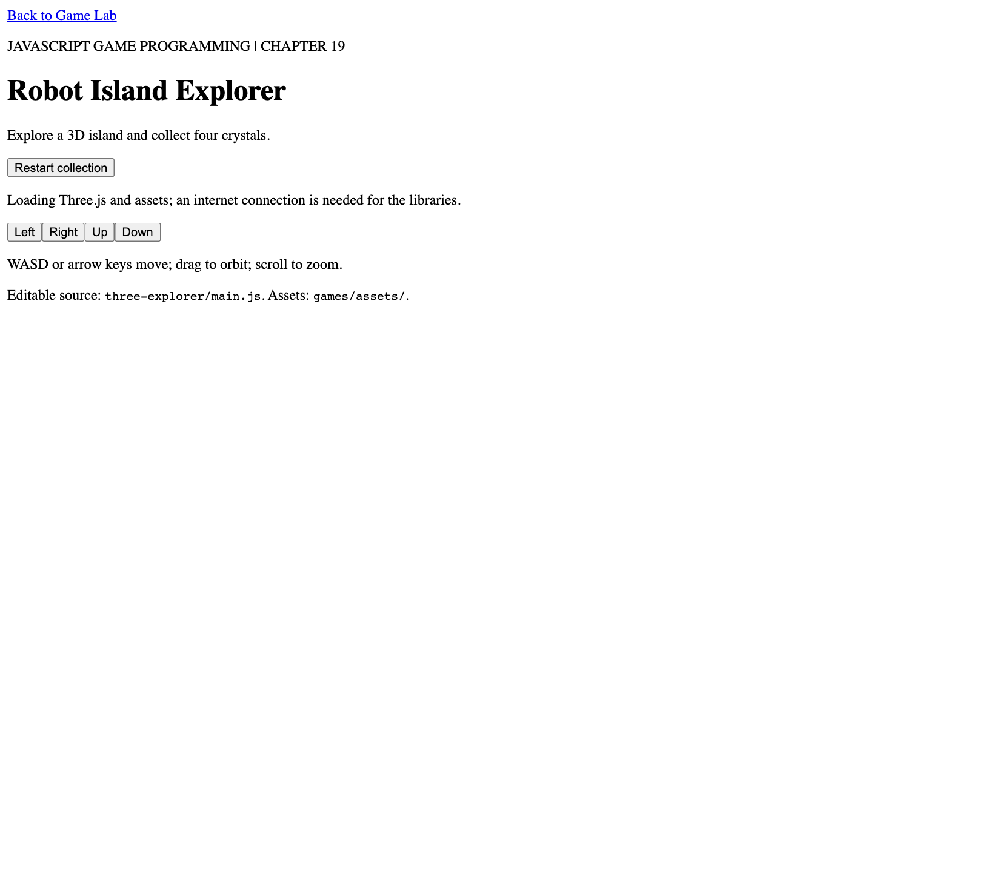
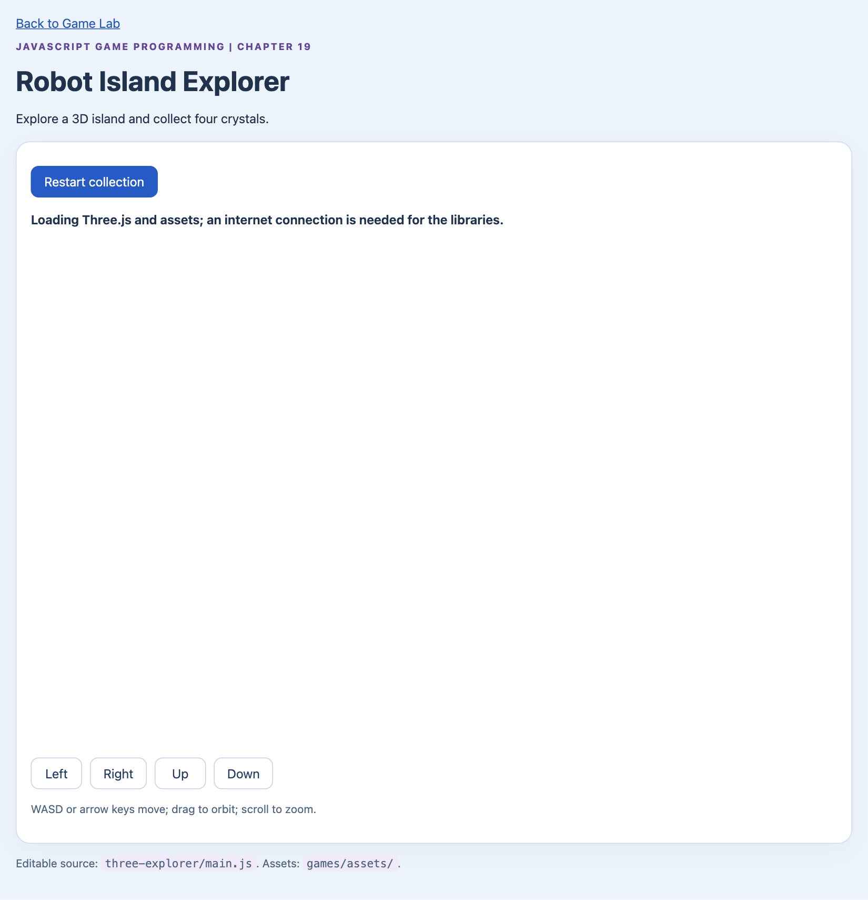
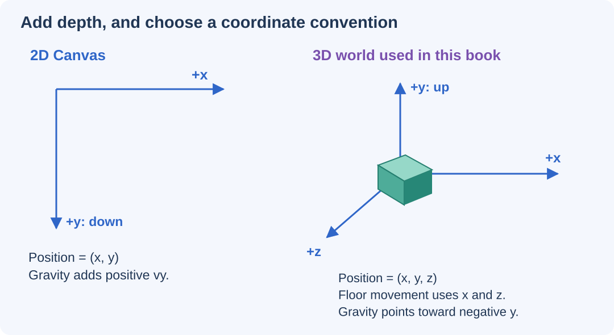
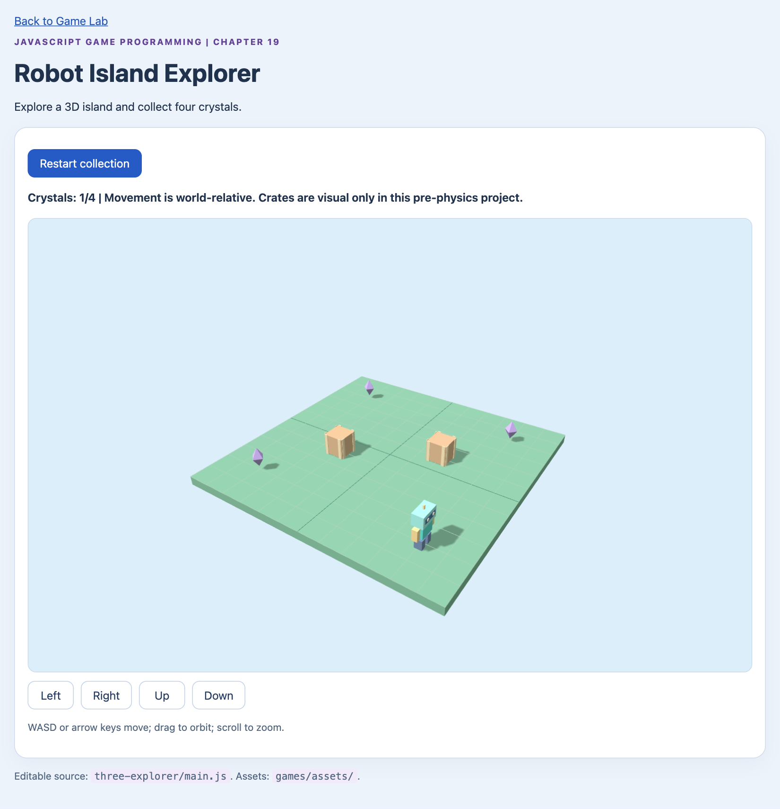
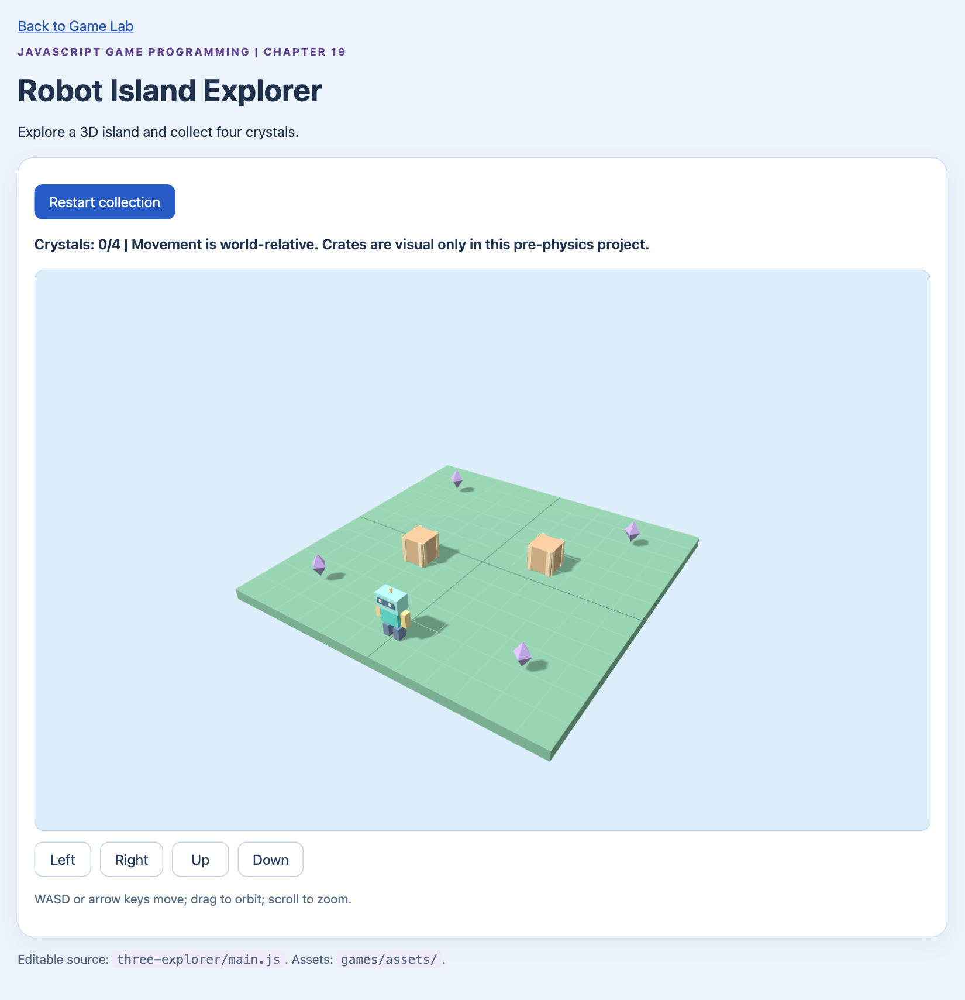

# Step into a 3D World with Three.js {#sec-ch20}

::: {.chapter-banner}
[GAME LAB 20 | Robot Island Explorer]{.game-title}
[Three.js]{.skill-chip} [Scene]{.skill-chip} [Camera]{.skill-chip} [3D coordinates]{.skill-chip}
:::

## Overview {.unnumbered}

Three.js helps you draw a 3D world. It does not automatically decide your game rules or make every object physically solid. A camera sees the scene; a renderer turns that view into pixels.

Create a 3D scene, position a camera, light a mesh, and move a character across a floor. Keep the familiar input-update-draw structure while adding a third coordinate.

::: {.callout-important .setup title="Local HTTP server required" icon="false"}

**Start the Game Lab server before opening this chapter's companion project.** Install Node.js LTS once, then double-click `start-game-lab.bat` (Windows) or `start-game-lab.command` (macOS) in `Quarto_Doc`. Open **[http://127.0.0.1:8000/games/](http://127.0.0.1:8000/games/)** and choose the project. Opening the game's HTML file directly with `file://` will not work. Follow the [step-by-step installation guide](../appendices/e-game-lab.qmd) if this is your first visit. These 3D projects also need internet access for library downloads by default; the guide explains optional offline setup.

:::

## Learning Objectives {.unnumbered}

By the end of this chapter, you will be able to:

- Explain the jobs of a scene, camera, mesh, and renderer.
- Arrange objects using three coordinates.
- Choose materials, lights, and a readable camera view.
- Move a player and test collection, camera controls, and resizing.

::: {.callout-note .big-idea title="Structure → Style → Behavior" icon="false"}

**Build the scene structure → Style the scene → Program game behavior.**

- **Build the scene structure:** Arrange the HTML stage and the 3D scene: meshes, floor, camera, and lights.
- **Style the scene:** Choose materials, lighting, and a camera view that makes the world easy to read.
- **Behavior:** Load the modules, move the player, collect crystals, and check resizing and camera controls.

Use this plan for the examples and exercises below. Reuse parts that already work; change only what the task needs. After each step, predict one result and check it.

:::

## Start with the familiar ideas

You already know that a game needs state, input, rules, and drawing. Those ideas still work. The major change is that a position now has three coordinates: `x`, `y`, and `z`.

Open **Robot Island Explorer** in the Game Lab. Move with WASD or the arrow keys and collect four crystals. Drag to orbit the camera and scroll to zoom. The decorative crates are intentionally not solid in this pre-physics project. We will give objects real physical behavior with Rapier later.

::: {.callout-tip .setup title="Set up the 3D projects" icon="false"}
Use the same local server from Chapter 16. The supplied 3D pages load **Three.js 0.180.0** and, where needed, **Rapier 0.17.3** from a CDN. These are pinned lesson dependencies, not a claim that they are the newest releases.

Internet access is required for those library downloads unless you run the optional vendoring script described in the Game Lab appendix. Your local images and GLB files are included. A WebGL 2-capable browser and graphics setup are required by this Three.js renderer; see the [renderer documentation](https://threejs.org/docs/pages/WebGLRenderer.html).
:::

## Learn the four scene jobs

A **scene** holds objects. A **camera** decides the viewpoint. A **mesh** combines geometry and a material. A **renderer** draws the scene from the camera's viewpoint.

Geometry describes shape: a cube, sphere, or a more detailed model. A material describes surface appearance. A light helps a lit material show its shape. A mesh with a dark material in an unlit scene may be present but difficult to see.

```javascript
import * as THREE from "three";

const scene = new THREE.Scene();
const camera = new THREE.PerspectiveCamera(50, 960 / 540, 0.1, 100);
camera.position.set(4, 3, 6);
camera.lookAt(0, 0.5, 0);

const robot = new THREE.Mesh(
  new THREE.BoxGeometry(1, 1, 1),
  new THREE.MeshStandardMaterial({ color: "#20b7a5" })
);
robot.position.y = 0.5;
scene.add(robot);
scene.add(new THREE.HemisphereLight(0xffffff, 0x456b55, 2));
```

<!-- game-stage-figures:shell -->

These stage views use the complete [companion page](../games/three-explorer/index.html). With its scripts disabled, HTML supplies the controls and CSS styles the page. The game world appears when JavaScript loads and draws it; the loading text in these static views is the HTML placeholder.

{#fig-ch20-stage-html fig-alt="Structure: HTML only, before CSS or JavaScript." width="100%"}

{#fig-ch20-stage-style fig-alt="Style: the same HTML with CSS applied; JavaScript is still off." width="100%"}

<!-- /game-stage-figures:shell -->

This fragment creates the scene objects. `games/shared/three-scene.js` completes the browser setup by creating `WebGLRenderer`, attaching its canvas, sizing it, and adding lights. The complete Explorer project connects that helper to controls, models, and the loop.

## Tell the browser where imports live

A browser needs to know what the bare name `"three"` means. The supplied HTML uses an **import map**, followed by a module script. JSON requires double quotes and does not allow comments.

```html
<script type="importmap">
{
  "imports": {
    "three": "https://cdn.jsdelivr.net/npm/three@0.180.0/build/three.module.js",
    "three/addons/": "https://cdn.jsdelivr.net/npm/three@0.180.0/examples/jsm/"
  }
}
</script>
<script type="module" src="main.js"></script>
```

Put the map before the module that uses it. Keep Three.js core and its addons on the same version. The companion pages also catch startup errors so a failed dependency load produces a message instead of an unexplained blank canvas. For the browser's mapping rules, see [MDN's import-map reference](https://developer.mozilla.org/en-US/docs/Web/HTML/Reference/Elements/script/type/importmap).

## Choose your coordinate convention

In this book's 3D worlds, `y` points upward. The floor lies in the `x-z` plane. Positive `x` moves right along the world axis; positive `z` moves toward the near side in the starting camera view. These are world directions, not permanent screen directions.

{#fig-ch20 fig-alt="Canvas uses x right and y down. The 3D world uses x, y up, and z depth, with floor movement in x and z." width="100%"}

**Read the picture:** Do not carry the 2D gravity sign into the 3D game unchanged. Downward motion increased `y` on the canvas. In this 3D convention, downward motion decreases `y`.

## Move across the floor

The Explorer uses world-relative controls: right changes `x`, and forward changes `z`. Normalize the two input components before applying speed.

```javascript
const direction = normalize2(horizontalInput, forwardInput);
robot.position.x += direction.x * speed * dt;
robot.position.z += direction.y * speed * dt;
```

<!-- game-stage-figures:behavior -->

The following captures run the complete companion project and exercise its controls.

{#fig-ch20-behavior-start fig-alt="Behavior: JavaScript loads the robot and crystals and renders the 3D island." width="100%"}

{#fig-ch20-behavior-collected fig-alt="Moving Up and Right to the first crystal removes it and updates the counter to Crystals: 1/4." width="100%"}

{#fig-ch20-behavior-restarted fig-alt="Restart collection restores all four crystals and resets the counter to zero." width="100%"}

<!-- /game-stage-figures:behavior -->

Our two-dimensional helper calls its second component `y`, but here that component is used for the world's `z` coordinate. A helper's field name does not automatically change the coordinate system of your game.

The Explorer also clamps the robot to the island boundary. This is a simple rule, not a general 3D collision solver. Distance checks on the floor collect crystals; decorative crates still do not block motion.

## Move the camera without moving the robot

`OrbitControls` changes the camera viewpoint around a target. It is imported as a Three.js addon:

```javascript
import { OrbitControls } from "three/addons/controls/OrbitControls.js";
const controls = new OrbitControls(camera, renderer.domElement);
controls.target.set(0, 0.5, 0);
controls.enableDamping = true;
```

Call `controls.update()` during drawing when damping is enabled. Orbit controls are for viewing the scene, not for solving player movement. See the [official OrbitControls reference](https://threejs.org/docs/pages/OrbitControls.html).

::: {.callout-note .advanced-study title="Advanced Study | World-relative and camera-relative controls" icon="false" collapse="false"}
After orbiting the camera, world `+x` may no longer look like screen-right. The Explorer deliberately keeps world-relative movement so you can learn the axes.

A camera-relative controller instead builds movement from the camera's right and forward directions. For a floor-walking character, project forward onto the `x-z` plane, normalize it, and combine it with right. Otherwise, pointing the camera upward could make a supposed walking controller fly.

Either design can be valid. The important step is to choose one and describe it clearly to the player rather than mixing them accidentally.
:::

## Keep the view the right shape

When the browser window changes size, resize the renderer and update the camera's aspect ratio. Changing only the canvas size can stretch the picture.

```javascript
renderer.setSize(width, height, false);
camera.aspect = width / height;
camera.updateProjectionMatrix();
```

The shared setup watches the display area with `ResizeObserver` and limits the device pixel ratio to two. The limit trades some sharpness on dense displays for less rendering work. The [PerspectiveCamera reference](https://threejs.org/docs/pages/PerspectiveCamera.html) explains its projection properties.

::: {.callout-note .advanced-study title="Advanced Study | A camera angle is not an object position" icon="false" collapse="false"}
The camera's field of view is measured in degrees in the `PerspectiveCamera` constructor. Object rotation values such as `robot.rotation.y` use radians. Mixing those units can produce surprising rotations.

The camera's near and far distances bound what it can see. A model outside that range may disappear even though its data is loaded correctly. Also check the camera direction, model scale, lighting, and whether the model is behind the camera before concluding that the loader failed.
:::

## Make it your own

::: {.callout-tip .challenge title="Level up" icon="false"}
Move the starting camera higher, change the island material, and place one extra crystal. Then orbit the camera halfway around and explain why the movement keys now look different. Keep the world controls unchanged while you investigate.

1. **Build the scene structure:** Place the extra crystal and choose the starting camera position.
2. **Style the scene:** Adjust the island material and verify the view stays readable.
3. **Behavior:** Check collection and orbit controls, then compare apparent movement with unchanged world-relative keys.

:::


**Complete companion source:** [Robot Island Explorer](../games/three-explorer/index.html), [main.js](../games/three-explorer/main.js), and [shared Three.js setup](../games/shared/three-scene.js).

## Check your development flow {.unnumbered}

After your exercise or challenge, explain what you built, what you styled, and which game behavior you programmed. If you reused a stage unchanged, say why it already met the task. Record one predicted result and the result you observed, then choose the next small improvement.
